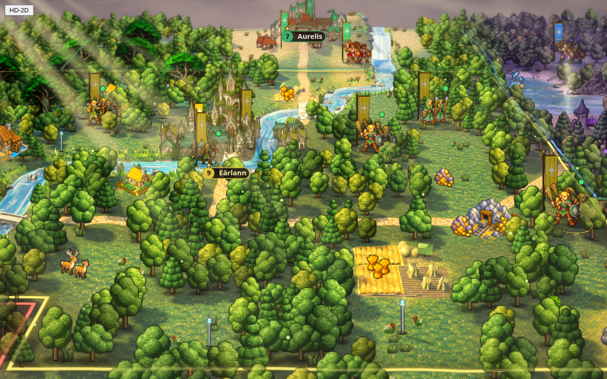
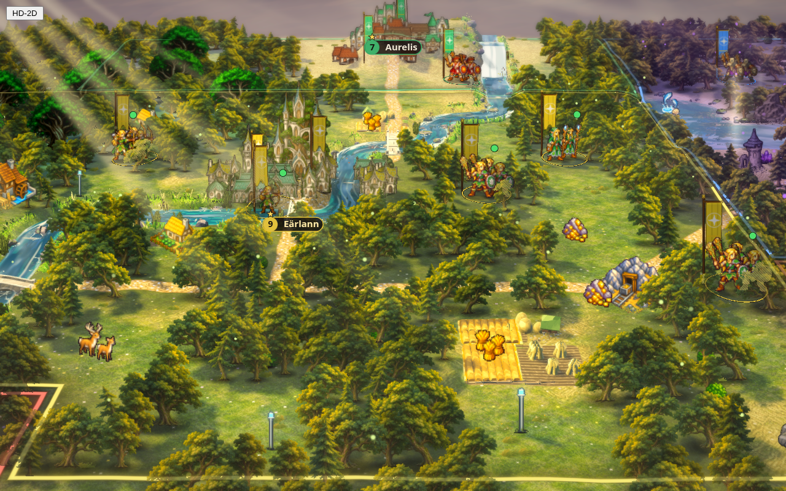
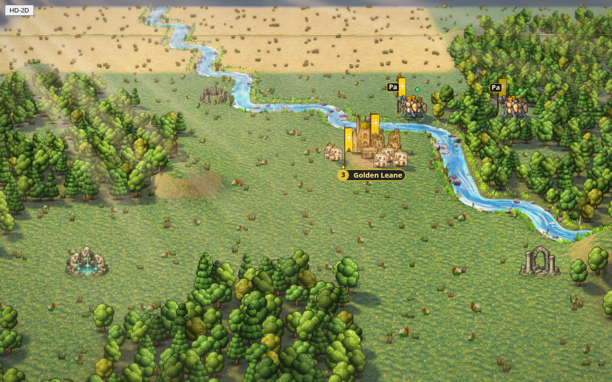
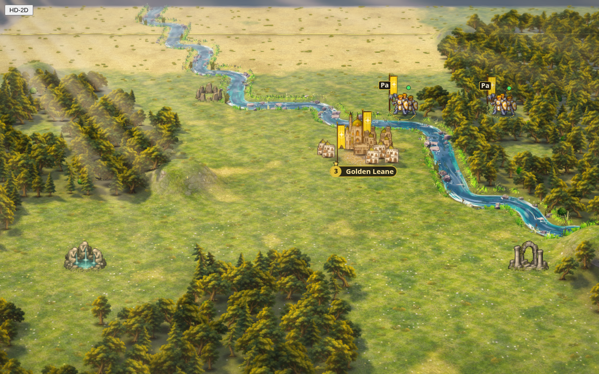

# Painterly terrain preview

This branch studies the owner's Golden Leane / Pool of Tears screenshot. It is a
terrain and vegetation prototype awaiting visual approval before merging to master.
It builds on the current HD-2D renderer, keeping its camera, game state, selection,
visibility rules, city kit, units, fog and lighting pipeline.

## Approach

The reference gets its depth from small material details and strong silhouettes:
olive and golden meadow patches, layered foliage with dark interiors and warm leaf
tips, turf above exposed grey hill rock, and teal rivers crossed by white currents.
The original map's coarse tree cards and uniform ground hid much of that character.

- Twelve original painted cards replace ordinary broadleaf trees, conifers, grass
  tufts and flowers. Trees have 144 art pixels of detail, scatter 48; their world
  heights and the placement/clearing rules remain comparable to the previous art.
- A new 256-texel grass material retains fine blades and small flower flecks. The
  existing ground importer keeps tile edges seamless and height in alpha.
- Two mipmapped utility texture reads restore broad meadow variation independently
  of plot edges. Grassland and plains keep their distinct centre colours.
- Hill crowns retain turf, with broken grey mineral patches on their steep flanks.
  Rock texture on the exposed faces is larger and less soil-coloured.
- Rivers have darker teal pools, quieter sky reflections and thinner white currents.
  These shader additions apply to HD-2D only; the legacy modelled lab mode keeps its
  existing materials. No global brightness or saturation increase is used.

## Samples

The committed before/after images use the same fixed map, viewport, camera and
frozen animation time. They are renders of the actual MapHd2d pipeline, not image
generation mockups. The Golden study composition is a synthetic renderer fixture,
not a save or a gameplay scenario.

| Current master look | Proposed terrain |
| --- | --- |
|  |  |
|  |  |

The Golden study pair uses `ts=128`; [the closer view](art/terrain-study-close.png)
uses `ts=168` to show the trees, meadow and river in more detail.

Run the sample scene with:

```sh
node tools/r3d-lab.mjs --serve
# /lab/lab.html?scene=golden-study&renderer=hd2d&ts=168&force3d=1
node tools/r3d-lab.mjs --out study.png --w 1280 --h 800 \
  --query 'scene=golden-study&renderer=hd2d&ts=168'
```

The original overview uses `scene=hd2d&renderer=hd2d&ts=168`, also 1280 by 800.
The baseline renderer is revision `50f681a`; master subsequently added the unrelated
Erebus Terra map script (`46ba239`). The new scene fixture is copied unchanged into
both renderer versions when making its comparison.

## Assets and reproduction

All three original image generation sources, exact prompts and generation settings
are retained in [tools/hd2d/source](../tools/hd2d/source/painterly.json). They were
generated with `image_gen` on November 15, 2026. No screenshot art was extracted.
The source sheet keeps three trees or plants per row, with broadleaf trees/grass
above conifers/flowers. Import them with:

```sh
python3 tools/hd2d/painterly.py \
  tools/hd2d/source/painterly-trees.png \
  tools/hd2d/source/painterly-meadow.png \
  tools/hd2d/source/painterly-scatter.png
```

The importer retains painted card colours and native alpha coverage rather than
adding a pixel-art outline. The old small tree and grass assets are retained, as
are snowy, ancient, jungle and dead-tree feature assets. New cards fit the existing
256 by 256 texture-array layers; the normal asset build automatically embeds them.

## Verification and remaining refinements

Use `tools/agents/build-tree.sh --test`, `ffh data`, `tools/web-check.sh`, the
SwiftShader Huge-map reveal check, and an old/new stability comparison for this batch.
Detailed results accompany the pull request. The review images above should be
judged at gameplay zoom; the source sheets are authoring assets.

The Huge-map reveal check passed on SwiftShader: 128 by 80 plots, 203 seas,
11,897 ms from reveal to complete frame against the 30,000 ms limit, with no browser
errors. The browser checks passed all 198 tests with none skipped. The fixed pan
comparison improved mean image difference from 8.43 to 7.64.

This is a first pass toward the reference. Ancient/jungle/snow forests still use
their existing art, landmarks and units retain their established style, and actual
waterfalls remain broad ribbons. A closer reference match would add irregular drop
silhouettes and another art pass for those remaining feature families. Fog and UI
were kept outside this terrain pass. Merge only after the owner approves the samples.
