# Minor leaders

210 minor leaders for the original 21 Fall from Heaven civilizations, with ten per civilization. Each has a portrait, three or four sentences of backstory, an alignment, and traits from the game. Three Balseraph leaders are rival facets of the same living Perpentach; another is a demon who escaped a summoned performance.

These leaders can enter play as Persons of Note or lead a breakaway faction. They take priority over major and legacy minor leaders when a faction forms. The game uses its seeded RNG to choose from the available preferred leaders.

[Open the searchable illustrated catalog](catalog.html).

Personal traits are followed by inherited civilization traits. Alignment sets the faction's starting alignment; it does not remove civilization rules, races, unit restrictions, or inherited traits. Illian Agnostic and Infernal Barbarian, where listed, are personal traits matching their existing leaders. The Sundering retains its existing eligibility rules, including its Sheaim and Infernal exemptions; other city revolts and colonial releases use the same preferred leader pool.

## Civilizations

- [Bannor](#bannor)
- [Malakim](#malakim)
- [Elohim](#elohim)
- [Mercurians](#mercurians)
- [Luchuirp](#luchuirp)
- [Kuriotates](#kuriotates)
- [Ljosalfar](#ljosalfar)
- [Khazad](#khazad)
- [Sidar](#sidar)
- [Lanun](#lanun)
- [Grigori](#grigori)
- [Hippus](#hippus)
- [Amurites](#amurites)
- [Doviello](#doviello)
- [Balseraphs](#balseraphs)
- [Clan of Embers](#clan_of_embers)
- [Svartalfar](#svartalfar)
- [Calabim](#calabim)
- [Sheaim](#sheaim)
- [Infernals](#infernal)
- [Illians](#illians)

## Bannor

### Maereth Ashledger — The Auditor of Oaths

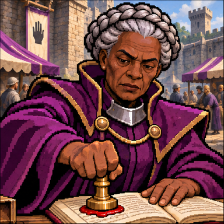

**Neutral · Personal traits:** Organized, Philosophical. **Inherited:** Guardsman.

*The free-land towns demand that noble Families prove their obligations as rigorously as common conscripts must.*

Maereth inherited a village muster book in which the same dead men had paid military taxes for three generations. Her investigation exposed a hereditary Order that collected their equipment money while sending their descendants to war without armor. Now a league of free-land towns accepts her judgments before those of the estates, although her insistence that a sworn contract outranks a charitable exception has ruined honest households as well as corrupt ones.

**Portrait direction:** Exacting civic judgment. Palette: Deep aubergine purple dominant, antique brass secondary, pale parchment highlights. Activity: Presses a brass judgment stamp into red wax on an open muster ledger, bent wrist and firm downward motion visible

### Odran Vale — Iron Mercy

**Evil · Personal traits:** Spiritual, Defender. **Inherited:** Guardsman.

*A Bannor prison chaplain turns the promise of safety into permanent confinement and inherited punishment.*

Odran tended prisoners who had survived demonic captivity, and came to believe that freedom itself gave evil its opportunity. His Order of the Closed Hand began by sheltering threatened families, then locked its sanctuary gates and declared that their children must remain until every outside temptation had been destroyed. Its fortress towns now export inquisitors who sentence the innocent for the sins they might one day commit, all while Odran continues to preach deliverance from Hell.

**Portrait direction:** Paternal carceral calm. Palette: Ivory white dominant, coal black secondary, dull gold glints. Activity: Turns a heavy iron key in the lock of a barred sanctuary door beside his face, other hand drawing the door shut

### Sera Vell — Mother of the Free Land

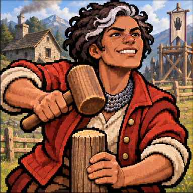

**Good · Personal traits:** Expansive, Charismatic. **Inherited:** Guardsman.

*Civilian settlement and citizenship outside the estates, led by a veteran who values the lives a crusade must eventually make possible.*

After three campaigns, Sera returned to find her free-land village serving an estate that would not grant her foreign-born comrades homes. She led the veterans and their families beyond its boundary stones, where they built a fortified town and elected their officers anew each spring. Her growing league still sends soldiers against the demons, but makes the unfashionable demand that victory should earn every survivor a field, a vote, and permission to lay down a sword.

**Portrait direction:** Hopeful stubborn vigor. Palette: Vermilion red dominant, warm cream secondary, small iron-gray accents. Activity: Drives a wooden boundary peg with a short wooden mallet, forearm lifted mid-stroke while her other hand steadies the peg

### Tovin Cinderwright — The Breach-Mason

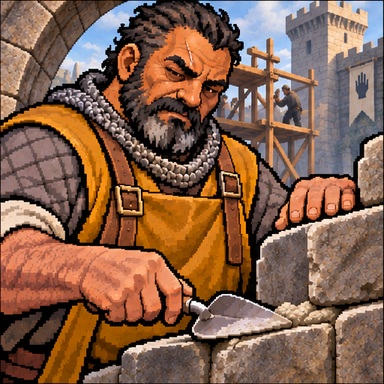

**Neutral · Personal traits:** Industrious, Ingenuity. **Inherited:** Guardsman.

*A military engineer makes reconstruction and salvage into an independent civic power.*

Tovin learned siegecraft by repairing the same border fortress after four different armies broke it. When an Order abandoned the place as cursed, he bought its ruins for the price of its salvage and rebuilt the gate around the tools his employers had left behind. Masons, armorers, and displaced laborers now rally to his chartered strongholds, where any creed may find work but every traveler pays for the walls that keep it safe.

**Portrait direction:** Shrewd absorbed craftsmanship. Palette: Mustard ochre dominant, smoke gray secondary, copper tool glints. Activity: Spreads fresh mortar into a stone gate joint with a short trowel, his other hand leveling the block

### Ysabet Renn — The Last Witness

**Good · Personal traits:** Creative, Philosophical. **Inherited:** Guardsman.

*The Bannor memory of captivity becomes a public check on the cruelty of their own armies.*

Ysabet was trained to recite the names of the ancestors who escaped Hell, until an old soldier asked why her rolls omitted the civilians killed in their descendants' wars. She began staging testimony in the market squares, giving the bereaved the speaking parts and requiring accused officers to answer before their own companies. Her Witness Houses preserve the Bannor's sacred history alongside these less comfortable records, and their militias have sworn that no commander may burn an archive to protect a reputation.

**Portrait direction:** Grave attentive courage. Palette: Royal blue dominant, bright silver secondary, white memorial cords. Activity: Writes a witness statement with a long white quill on a slanted public lectern while looking up to listen to an unseen speaker

### Leora Bellfound — Keeper of the Mist Bells

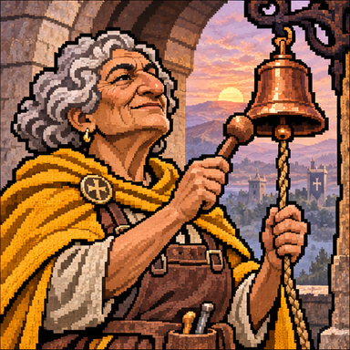

**Good · Personal traits:** Industrious, Spiritual. **Inherited:** Guardsman.

*Signal crews organize ruinously exposed marches into a league of mutual aid.*

Leora was recasting a cracked abbey bell when she realized that none of the valley hamlets could hear the fort's warning. She used the abbey's bronze allotment to build a chain of smaller towers, staffed in turn by shepherds and deserters. When an officer came to requisition the new bells, every hamlet rang its refusal.

**Portrait direction:** Practical warmth. Palette: Saffron yellow wool, copper bells and honey-colored dawn. Activity: Rings a small suspended bell with a wooden striker

### Beren Halflight — Captain of the Homeward Column

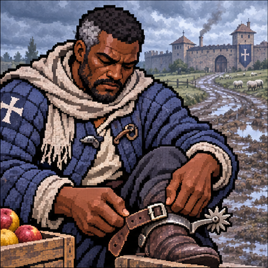

**Good · Personal traits:** Charismatic, Magic Resistant. **Inherited:** Guardsman.

*A veteran insists that surviving crusaders can decide where their service ends.*

Beren led a defeated column home through country its own quartermasters had stripped bare. He traded the horses first, then the officers' spurs, keeping a tally of every farmer who fed them. The farmers now come to him when conscription parties arrive, and the old column assembles without a drum.

**Portrait direction:** Weary resolve. Palette: Slate blue padded coat, white linen and cold sky. Activity: Unbuckles a spur over a wooden produce crate

### Hamira Stoneford — Reeve of the Third Ford

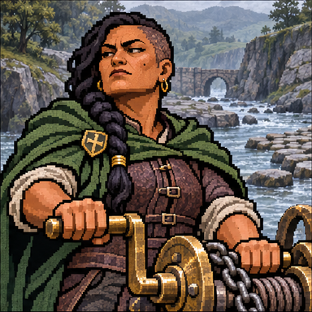

**Neutral · Personal traits:** Financial, Defender. **Inherited:** Guardsman.

*A border crossing buys its autonomy by charging both estate lords and the troops they send to collect.*

At flood season Hamira commandeered a noble's empty granary to keep the ford open. Her ferry carried every traveler regardless of rank, provided their fee paid for another stone in the approach. Now she can turn back a duke's whole levy by lifting the chain and pocketing the handle.

**Portrait direction:** Unmoved authority. Palette: Juniper green cloak, brass winch and gray water. Activity: Cranks the brass handle of a river-chain winch

### Cedric Stave — Marshal of the Hallowed Mile

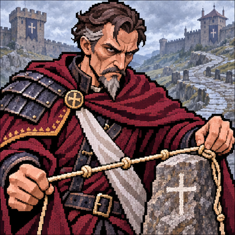

**Evil · Personal traits:** Aggressive, Organized. **Inherited:** Guardsman.

*A road marshal makes a strip of country into a hereditary military jurisdiction.*

Cedric's patrol brought back a holy banner from a road where three whole pilgrim companies had disappeared. In return he was given the width of a spear on either side of that road and the power to try anyone who set foot in it. He has spent the years since paying surveyors to discover how wide a spear can be.

**Portrait direction:** Meticulous menace. Palette: Oxblood cloth, black steel and chalk highlights. Activity: Stretches a knotted measuring cord across a boundary post

### Dalia Chalkwall — The Barracks Schoolmaster

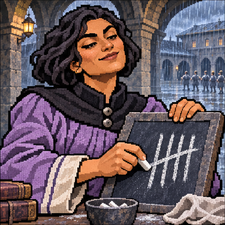

**Neutral · Personal traits:** Creative, Philosophical. **Inherited:** Guardsman.

*A barracks teacher gives common households the means to read the laws that bind them.*

Dalia was put in charge of recruits who could recite whole prayers but could never check a pay docket. She chalked the articles of service on the wall, where the recruits began leaving questions under every line. When the wall was plastered over, her pupils walked out with the questions memorized and started schools of their own.

**Portrait direction:** Dry amusement. Palette: Lavender smock, graphite slate and pale chalk. Activity: Draws a large tally mark on a black slate

## Malakim

### Nadira bint Harel — The Well-Speaker

**Good · Personal traits:** Expansive, Organized.

*Desert survival depends on institutions for sharing water as well as the sun-priest's revelation.*

Nadira settled a blood feud by tracing two rival wells to the same underground spring and making both clans repair its ancient channels. She carried the resulting water covenant from oasis to oasis, offering every household a measured share in return for labor when the channels failed. Her confederacy honors Lugus, but judges its leaders by whether water reaches the last tent rather than by the brightness of their visions.

**Portrait direction:** Measured generous resolve. Palette: Turquoise dominant, sand beige secondary, copper highlights. Activity: Pours a precise measure of water from a copper cup into an oasis sluice bowl, left fingers marking the agreed waterline

### Qasir al-Nahar — The Unshadowed Judge

**Evil · Personal traits:** Spiritual, Aggressive.

*A splinter interpretation of the light's demand for truth abolishes privacy and treats concealment as guilt.*

Qasir exposed a caravan master's hidden slave pens by tearing the roofs from his warehouses at noon. Applause convinced the young preacher that every locked door concealed an equal wickedness, and his followers began dismantling shutters, veils, and the screens around family courtyards. The cities under his judgment glow with polished mirrors while informers decide whose private grief must be dragged into the sun, a tyranny he still calls service to Lugus.

**Portrait direction:** Radiant intrusive certainty. Palette: Brilliant gold dominant, stark white secondary, bronze edging. Activity: Tilts a hinged sun mirror to direct a sharp beam into a dark doorway, free hand commanding its occupants to emerge

### Ilyan Saffronwake — Keeper of the Last Caravan

**Neutral · Personal traits:** Financial, Creative.

*Desert funerary trade, multicultural craft, and the business of carrying strangers home.*

Ilyan began as a spice merchant who found better-paying work returning caravan dead to the families awaiting them across the desert. His embalmers learned the burial customs of a dozen peoples, and their painted waystations became the only places where rival caravans would share a fire. He now governs a chain of prosperous mortuary towns whose contracts promise to bring anyone home, provided someone has paid the fee.

**Portrait direction:** Worldly meticulous tenderness. Palette: Saffron orange dominant, rich plum secondary, cedar-brown accents. Activity: Brushes fragrant resin onto a small painted funerary mask laid on a padded stand, concentrating on its delicate cheek

### Samet Nahr — Reader of the Veil

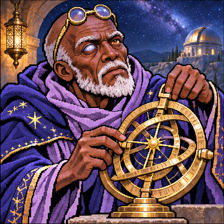

**Neutral · Personal traits:** Arcane, Philosophical.

*The Malakim desert also belongs to night travelers, astronomers, and those who study what the sun leaves unseen.*

Samet lost a caravan when a confident sun-priest dismissed his warning that its guide stars were wrong. He spent the next twenty years comparing desert observatories, lunar calendars, and the distorted heavens above old magical ruins. Scholars and night caravans now gather around his cold-lamped towers, where he teaches that reverence for Lugus requires admitting how much the daylight has yet to reveal.

**Portrait direction:** Unsparing nocturnal curiosity. Palette: Midnight indigo dominant, pale lavender secondary, aged brass glints. Activity: Rotates the nested brass rings of an astrolabe and aligns its sight toward the stars, both fingers visibly adjusting different rings

### Tareq Sandhearth — Captain of the Guest-Tents

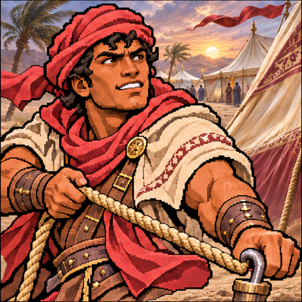

**Good · Personal traits:** Defender, Charismatic.

*The hospitality that first sheltered Varn becomes a military duty to protect an outsider, even against one's own hosts.*

Tareq guarded the guest-tents of an oasis whose elders agreed to surrender a foreign fugitive to a richer neighboring clan. Remembering the strangers who once sheltered Varn, he stood across the tent ropes and persuaded the watch to refuse the order. Refugees and disgraced hosts have since joined his moving camp, which offers sanctuary for one season and demands that every guest help defend the next arrival.

**Portrait direction:** Alert welcoming grit. Palette: Coral red dominant, weathered cream secondary, muted bronze accents. Activity: Hauls a taut guest-tent guy rope against a gust, bracing one forearm and reaching forward to set its fastening hook

### Zahir Whiteflint — The Road Under the Road

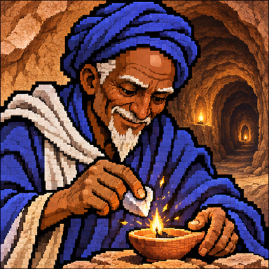

**Good · Personal traits:** Defender, Philosophical.

*Desert guides create commons beneath roads controlled by toll stations.*

Zahir explored cool tunnels beneath abandoned caravan roads while serving as a water bearer. When a debt caravan camped above one of the entrances, he brought its prisoners out one family at a time. His guides now count a route as sacred if a person can escape along it without paying.

**Portrait direction:** Alert kindness. Palette: Cobalt blue headwrap, white flint and deep sandstone. Activity: Strikes a white flint to light a shallow clay lamp

### Safiya of the Kiln — The Glass Gardener

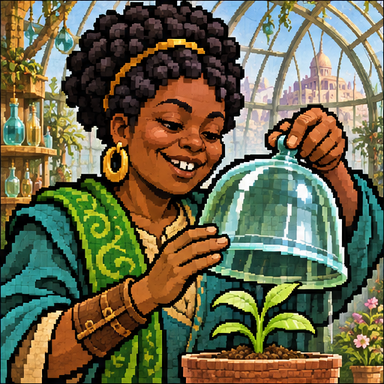

**Neutral · Personal traits:** Industrious, Arcane.

*Oasis workshops make shade and irrigation portable enough to challenge hereditary gatekeepers.*

Safiya grew up among glassblowers who tinted every window in the oasis except those of their own houses. She bought a heap of failed panes and laid them over a bed of roots, which survived the coldest desert night anyone remembered. People travel farther for a share of her kiln than they once traveled to pay court to the well lords.

**Portrait direction:** Delighted concentration. Palette: Malachite coat, straw gold and translucent aquamarine. Activity: Lifts a translucent glass cloche from a seedling

### Kamal Red Meridian — Warden of the Midday Gate

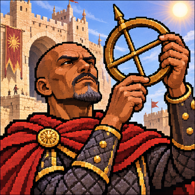

**Evil · Personal traits:** Aggressive, Organized.

*A commander makes the safe hours at a mountain pass into privileges to be earned.*

Kamal once shut his pass a minute late and lost a caravan to the raiders following it. He has fixed the gate hours to a bronze sight ever since, raising the bar for anyone whose shelter gives an enemy cover. The people who ask him to bend the rule usually end up living under the gate and working off their petition.

**Portrait direction:** Punitive vigilance. Palette: Scarlet scarf, honey bronze and bone sandstone. Activity: Tilts a bronze sighting ring toward the sun with both hands

### Luma Dunebright — The Festival of Returning Feet

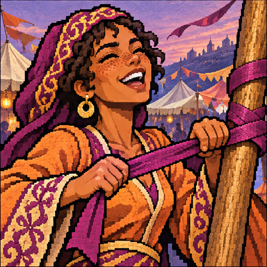

**Good · Personal traits:** Creative, Expansive.

*Market festivals coax scattered families back to places the dunes took.*

For years Luma rehearsed songs that her scattered kin could recognize without agreeing on all the words. She carried the best ones to the empty market at which her grandparents had met, and a few listeners put up tents. When they returned next year they brought roof beams, and Luma learned to sing loud enough to be heard over the work.

**Portrait direction:** Infectious delight. Palette: Apricot cloth, plum embroidery and dusk violet. Activity: Pulls a broad colored ribbon taut between both hands to lash a tent pole

### Nedim Saltwind — Master of the Buried Salt

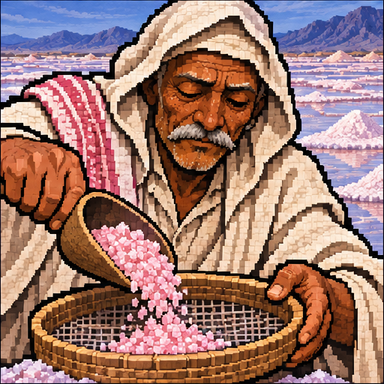

**Neutral · Personal traits:** Financial, Magic Resistant.

*Prospectors bring wealth to neglected camps and force rich towns to bid for their labor.*

Nedim was blinded in one eye after mistaking a salt lake's crust for firm ground. He sent apprentices back with long-handled rakes and paid them first from whatever they managed to bring out. His crews now auction their work from camp to camp, leaving richer towns to wonder why nobody has come to dig.

**Portrait direction:** Appraising patience. Palette: Ivory cloak, dusty rose and ultramarine shadows. Activity: Tips a scoop of pink salt crystals into a woven sieve

## Elohim

### Isrene Stone-Ear — The Patient Listener

**Neutral · Personal traits:** Philosophical, Arcane.

*A keeper of sacred places puts the needs of ancient sites ahead of the people now living beside them.*

Isrene discovered that the stones of a ruined shrine repeated fragments of conversations spoken before the Age of Ice. Her order spent decades listening, until a nearby village's quarry threatened to silence the oldest voices forever. She moved the villagers by force and founded a ring of protected sanctuaries, preserving irreplaceable knowledge while growing less able to hear the living petitioners at her gate.

**Portrait direction:** Remote patient wonder. Palette: Sage green dominant, pearl gray secondary, pale stone accents. Activity: Carefully brushes moss from an ancient carved stone with a soft narrow brush while one fingertip follows its newly revealed groove

### Damar of the Nine Bells — The Protector Without Release

**Evil · Personal traits:** Organized, Defender.

*The Elohim duty of guardianship hardens into occupation and the denial of a protected community's consent.*

Damar saved nine villages by erecting warning towers around a sacred valley and drilling every inhabitant in its defense. When the raiders were gone, he declared that the threat would return if anyone were allowed to leave, and placed each village under a monk-governor answerable only to him. His wardens now seize neighboring settlements for their protection, and the nine bells ring to announce both approaching enemies and the capture of escaping families.

**Portrait direction:** Watchful coercive stillness. Palette: Ink navy dominant, aged bronze secondary, small black leather accents. Activity: Pulls down a warning bell rope with one fist while his other hand gives a rigid stop signal across the gate

### Velka Thorne — Physician of the Unclean

**Good · Personal traits:** Expansive, Spiritual.

*The ancient mission to tend war's bystanders extends to the cursed and magically altered, despite the risks to sacred ground.*

Velka was ordered to close a hospice when its wounded began showing the marks of a battlefield curse. She carried its patients outside the shrine boundary and stayed with them, learning which symptoms were contagious and which merely frightened the healthy. Her scattered hospices now shelter altered soldiers and their families under strict precautions, supported by communities that remember the Elohim were healers before they were custodians of holy places.

**Portrait direction:** Tired practical compassion. Palette: Soft apricot dominant, warm cream secondary, herb green accents. Activity: Wraps a clean linen bandage around a patient’s offered forearm at the lower edge, checking its tension with two careful fingers

### Olen Marr — The Unwritten Chronicle

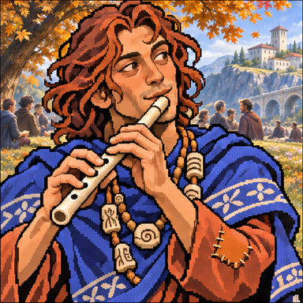

**Good · Personal traits:** Creative, Charismatic.

*An oral historian restores the Elohim tradition of keeping ordinary knowledge alive in songs, outside guarded archives.*

Olen was an archive attendant until a fire destroyed the only written account of the valley where his grandparents had lived. He began teaching its planting lore, recipes, and names as songs to traveling children, then added the histories that village councils preferred to forget. Communities now follow his wandering schools because their memory belongs to everyone who can sing it, although several great monasteries resent a chronicler they cannot quietly dismiss or censor.

**Portrait direction:** Restless communal delight. Palette: Cobalt blue dominant, rust orange secondary, pale bone highlights. Activity: Plays a simple bone flute with fingers actively covering its holes, eyes turned toward listeners beyond the frame

### Thesra Bel — Warden of the Quiet Gate

**Neutral · Personal traits:** Financial, Organized.

*The secular town that feeds a holy order insists on solvency, neutrality, and civilian authority over its guardians.*

Thesra supplied a monastery whose guardians kept promising refuge without counting how many mouths the surrounding farms could feed. During a siege she took control of its warehouses, rationed the grain, and negotiated passage for the children while the abbot still debated the sanctity of the road. Elected warden by the town afterward, she funds sanctuary through tolls and enforceable contracts, refusing both the army that demands free provisions and the supplicant who cannot accept the terms.

**Portrait direction:** Brisk unsentimental competence. Palette: Slate gray dominant, jade green secondary, iron-black trim. Activity: Cuts the seal-cord from a grain sack with a small utility knife while her other hand catches the opened flap for rationing

### Farah Quietwater — Custodian of the Shared Bank

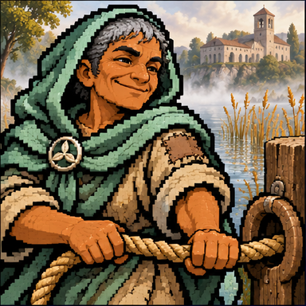

**Good · Personal traits:** Expansive, Defender.

*Former enemies find sanctuary on a floodplain that requires them to build together.*

Farah kept a pair of flood markers on opposite banks because neither village would trust the other to read its own. One spring both markers vanished, and paddlers from both villages followed her to recover them. Their shared embankments outlasted the emergency, even after both abbots began arguing about who could claim the work as a miracle.

**Portrait direction:** Steadfast fellowship. Palette: Seafoam green cloak, ochre reeds and pearl morning fog. Activity: Pulls a heavy rope through a wooden mooring ring

### Matteo Linden — The Lay Host

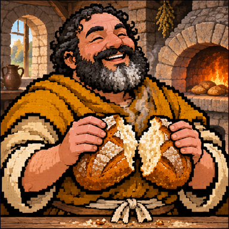

**Good · Personal traits:** Charismatic, Philosophical.

*Pilgrims establish independent hostels on roads where holy orders will only admit their own.*

Matteo's sister came home from a pilgrimage barefoot after a steward refused their family offerings. He bought a ruined bakehouse and left the door open to the first stranger who reached it. There are now lay houses in six provinces, each with a table long enough to seat both pilgrims and the people they are fleeing.

**Portrait direction:** Unshowy hospitality. Palette: Ochre wool, brick brown and warm cream. Activity: Tears a scored loaf into two large pieces

### Imena Wakefold — Warden of the Unmarked Sleep

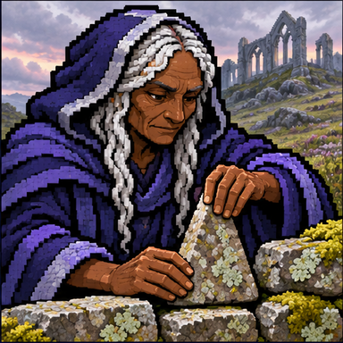

**Neutral · Personal traits:** Arcane, Magic Resistant.

*One sanctuary keeps a sealed burial hill free of both relic hunters and official custodians.*

Imena cleared a ruined chapterhouse and found that the dirt beneath its floor whispered living people's names. Her order marked the site on no maps and used the stones to build an ordinary sheepfold. It now shelters families whose ancestors would be instruments in somebody else's hands if the fold's true boundary became known.

**Portrait direction:** Quiet alertness. Palette: Deep indigo layers, gray-green lichen and silver dusk. Activity: Places a triangular stone upright in a gap between fieldstones

### Levan Pledge — The Collector of Sanctuary

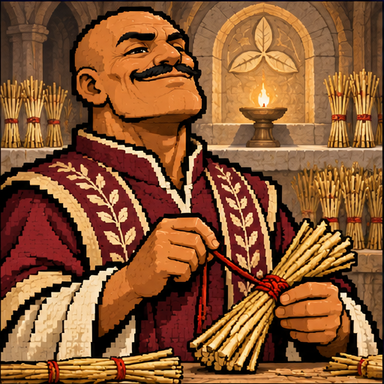

**Evil · Personal traits:** Financial, Spiritual.

*A keeper of holy hospitality converts guests' gratitude into debts they can never repay.*

Levan started collecting vows of thanks while the refugees in his care still had no money. He kept each on a reed slip and redeemed small promises first, for a morning's labor or a winter blanket. The bundle has grown hefty enough that he can decide who marries, who travels, and which children will keep the sanctuary books.

**Portrait direction:** Smiling control. Palette: Wine red vestment, aged ivory and umber. Activity: Ties a small reed bundle with a narrow red cord

### Enna Bramblehook — Gardener of the Siege Acre

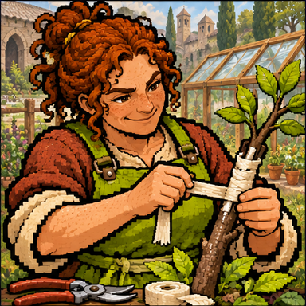

**Neutral · Personal traits:** Industrious, Ingenuity.

*A city's gardeners gain authority by keeping famine at bay through practical seed craft.*

Enna watched the gardens inside a siege ring go to seed as most of the remaining land was requisitioned for troops. She grafted bitter roots onto fruiting plants, then sent the cuttings to households too poor to buy seed. When the walls reopened, local families kept exchanging plants through her long after the old ration masters had run out of work.

**Portrait direction:** Resourceful focus. Palette: Lime green apron, pale cypress and russet accents. Activity: Binds a leafy graft with a strip of pale linen

## Mercurians

### Serediel — Guardian of the Threshold

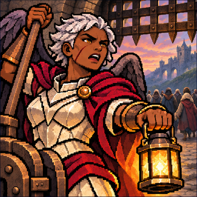

**Good · Personal traits:** Defender, Spiritual.

*A rebel angel interprets the war against demons as a duty to protect the living who are caught in it.*

Serediel once held a passage into Hell open while Basium's warriors pursued a retreating demon host. Mortals fleeing in the other direction forced her to choose between closing the trap and keeping their escape route clear. She stayed until the last child crossed, and now leads angels and mortal auxiliaries who measure a battle by the people brought safely home as well as the demons destroyed.

**Portrait direction:** Fierce protective urgency. Palette: Warm ivory dominant, deep crimson secondary, bronze highlights. Activity: Lifts a heavy gate portcullis lever with one arm while the other sweeps a lantern outward to guide escapees through

### Othra — Wings of Lead

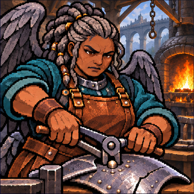

**Neutral · Personal traits:** Organized, Industrious.

*The rebel host needs roads, workshops, and mortal supply agreements as urgently as another glorious charge.*

Othra counted the hammers, sandals, and grain sacks abandoned after a Mercurian victory and realized that the next campaign would starve its mortal allies. She established repair yards along the host's route, buying supplies through fixed agreements instead of letting victorious angels requisition whatever they pleased. Her garrison towns are now indispensable to the crusade, but she will withhold a bridge or a wagon train from any commander who refuses to honor the price.

**Portrait direction:** Indispensable stubborn industry. Palette: Burnished copper dominant, deep teal secondary, charcoal accents. Activity: Closes rivet-setting pincers on a damaged armor plate clamped to a workbench, pressing with both hands

### Talvek — The Unforgiven

**Evil · Personal traits:** Aggressive, Charismatic.

*An anti-demon Mercurian splinter mistakes uncompromising purpose for righteousness and enslaves the people it claims to defend.*

Talvek returned from Hell with his wings burned and the names of his lost company carved into his armor. He decided that mortal hesitation had prolonged the war, and began binding rescued settlements to compulsory service until the last demon in existence was dead. His followers still fight the Infernals with terrible courage, but execute deserters and take children as guarantees of obedience, making a prison of the liberation they proclaim.

**Portrait direction:** Charismatic merciless conviction. Palette: Obsidian black dominant, scarlet red secondary, cold silver edging. Activity: Tightens a campaign oath chain across the map-table with a ratcheting gauntlet while raising the other hand to demand an oath

### Naeviel — Singer of the Last Hymn

**Good · Personal traits:** Creative, Philosophical.

*The immortal host must preserve the particular lives of the dead instead of treating every returning soul as another soldier.*

Naeviel welcomed newly arrived angels to the host and heard them struggle to recall the families they had left behind. She gathered their remaining memories into laments, then sent mortal singers to carry those songs back to the villages that still waited for news. Angels who fear becoming nothing but weapons gather around her memorial courts, where a soul is given time to remember its name before anyone offers it a sword.

**Portrait direction:** Tender defiant remembrance. Palette: Amethyst violet dominant, luminous silver secondary, pale blue undertones. Activity: Strikes a hanging memorial chime with a slender silver beater while the other hand shapes the rhythm of a sung lament

### Istran — Warden of the Borrowed Dawn

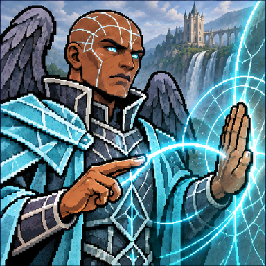

**Neutral · Personal traits:** Arcane, Magic Resistant.

*A Mercurian ward-maker seeks to contain supernatural warfare itself, even when the host wants unrestricted access to its magic.*

Istran survived a battle in which allied spells collapsed the shelter he had been ordered to defend. He began building layered wards that smothered hostile magic and insisted that friendly summoners leave their workings outside the same boundary. The mortal enclaves beneath his pale barriers pay for his protection and live under his severe restrictions, while Mercurian captains argue over whether the sanctuaries preserve their cause or obstruct it.

**Portrait direction:** Exacting guarded concentration. Palette: Ice cyan dominant, dark graphite secondary, pale platinum lines. Activity: Draws a luminous ward circle in the air with two outstretched fingers while the other palm presses shut a crack in the barrier

### Aureth Feather-Ash — Herald of the Borrowed Body

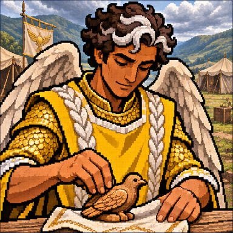

**Good · Personal traits:** Spiritual, Charismatic.

*An angel returns the belongings of the dead and gives their families a voice in the celestial host.*

Aureth's first body still carried a wooden badge carved by the soldier's daughter. He tracked down the family and found a line of others asking the host for possessions no officer had thought to collect. His companies now return one keepsake for every body they borrow and ask the survivors to name the next city they defend.

**Portrait direction:** Earnest humility. Palette: Sun yellow tabard, pale feathers and cedar brown. Activity: Lowers a small carved wooden bird onto a folded cloth

### Meriel Bronze Dawn — Master of the Landing Steps

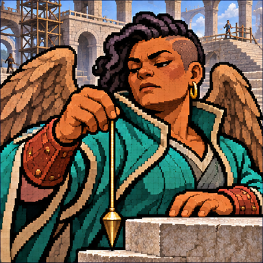

**Neutral · Personal traits:** Industrious, Expansive.

*An angelic works corps claims the right to govern the towns it rebuilds.*

Meriel watched the first winged regiment crush a water tower when its soldiers landed in an unfamiliar square. She devised stepped stone platforms that could take the weight and leave the wells accessible. The engineers who build them remain after the troops march, arguing that a garrison is no better than its stairs.

**Portrait direction:** Matter-of-fact command. Palette: Turquoise overcoat, terracotta and warm gray wings. Activity: Holds a plumb bob over the edge of a stone step

### Caradriel Pale Fire — The Relentless Dawn

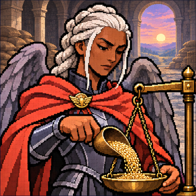

**Evil · Personal traits:** Aggressive, Magic Resistant.

*An angel presses an unyielding war of prevention against any city judged capable of harboring demons.*

Caradriel's company took an unguarded gate and lost half its borrowed bodies to a demon sheltering in a grain store. She brought the grain scale back to camp and made it the emblem of a tribunal that could seize supplies on suspicion alone. Her towns now run on confiscated grain and pray each morning to remain above suspicion.

**Portrait direction:** Austere conviction. Palette: Coral red officer's cloak, shadow steel and gray feathers. Activity: Pours grain from a requisitioned bronze scoop into a scale pan

### Sorad Veiled Seal — The Annalist of Wings

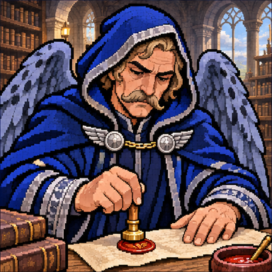

**Neutral · Personal traits:** Philosophical, Organized.

*Host archivists demand proof before assigning the resurrected to an earthly family.*

Sorad watched two villages claim the same angel after each lost a son at a disputed crossing. He established a waiting house for such cases and began recording what the angels could recall before they heard anybody's testimony. The house answers to him today because too many officers want its ledgers to endorse a convenient ancestry.

**Portrait direction:** Deliberate skepticism. Palette: Prussian blue hood, silver clasps and gray feathers. Activity: Holds a loose strip of vellum flat while affixing a wax seal

### Avona of Two Walls — Bridge Between Companies

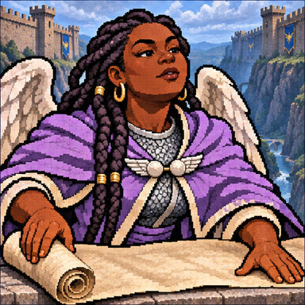

**Good · Personal traits:** Defender, Creative.

*Human and angel soldiers share command in a coalition formerly divided by rank.*

Avona carried messages between the city guard and an angelic unit whose commanders refused to share a table. She had two small benches built into the chasm wall so they could confer while both sides watched. By the second siege the benches wore smooth, and the troops called for Avona when their commanders disagreed.

**Portrait direction:** Open, assured attention. Palette: Lilac traveling mantle, alabaster wings and blue shadows. Activity: Unrolls a blank map across a narrow stone bench

## Luchuirp

### Mavra Wickhand — Keeper of Small Wonders

**Good · Personal traits:** Creative, Ingenuity.

*An itinerant toy-maker preserves ordinary Luchuirp lives rather than restoring an empire or accumulating a treasury.*

Mavra began repairing nursery toys in a refugee quarter where no family could afford a new golem. She fitted broken household constructs with little theaters that replayed the songs and trades of villages lost beneath the ice, carefully distinguishing their stored performances from living minds. Her traveling workshops became the meeting places of scattered clans, and their patrons asked her to arbitrate disputes that the city guilds ignored. She now leads a league of small makers whose first demand is that the poor inherit more of their ancestors than their debts.

**Portrait direction:** Warm mischievous ingenuity. Palette: Indigo blue with apricot accents. Activity: Threading a fresh cord through a wooden puppet's raised arm, pinching the thread between thumb and forefinger.

### Odrik Sluice — Master of the Water Clock

**Neutral · Personal traits:** Organized, Expansive.

*Agricultural infrastructure and the political power of maintenance crews, rather than celebrated masterworks.*

Odrik inherited a canal district whose magnificent ancient pumps had stopped because nobody remembered how to service them. He replaced their ingenious but irreplaceable mechanisms with plain golems that any village mason could mend. Farmers rewarded him with authority over their water schedules, and his maintenance crews gradually became a government crossing several guild jurisdictions. He will sell grain to either side of a war, but closes the sluices of anyone who tries to make his crews into soldiers.

**Portrait direction:** Blunt practical authority. Palette: Deep teal with rust orange accents. Activity: Turning a small brass sluice wheel while watching the water level rise inside its glass channel.

### Kelna Brasshear — The Patient Listener

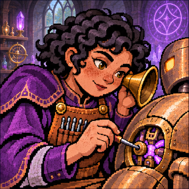

**Good · Personal traits:** Arcane, Philosophical.

*The ethics and safety of enchantment, without assuming every golem has Barnaxus's exceptional personhood.*

Kelna learned to diagnose failing enchantments by listening to the uneven hum inside a golem's chest. After a workshop accident, she discovered that a celebrated master had concealed a spirit-binding inside an otherwise ordinary laborer's frame. She insisted that the bound being be released and that every workshop publish what its animating spells actually contained. Apprentices and cautious householders have since formed a faction around her demand that mastery include responsibility for what answers when a maker gives an order.

**Portrait direction:** Gentle scientific curiosity. Palette: Rich violet with copper accents. Activity: Tuning a golem core with a tiny screwdriver while pressing a listening funnel against it with the other hand.

### Vorra Rentshaper — Mistress of Borrowed Hands

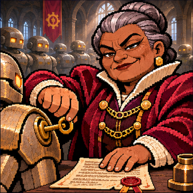

**Evil · Personal traits:** Financial, Organized.

*A dark Luchuirp offshoot turns the obedient servant economy into permanent dependence on its owners.*

Vorra rescued several indebted workshops by buying their golems and leasing the same servants back to them. Each repair introduced another proprietary enchantment, until an entire district could neither harvest nor build without her permission. When its council challenged her fees, she recalled every leased construct on the morning the flood defenses needed reinforcement. The council submitted, and her creditor cities now call submission to her contracts the price of civilization.

**Portrait direction:** Polished coercive assurance. Palette: Wine red with ivory accents. Activity: Turning a command key inside a golem's shoulder lock while her other palm pins a rental contract to the desk.

### Durn Pell — Builder of the Second Door

**Good · Personal traits:** Defender, Magic Resistant.

*A survivor's insistence on shelters and manual safeguards challenges the civilization's dependence on enchantment.*

Durn was a shelter mason when a hostile dispelling left his settlement's enchanted doors open during a raid. He saved its children through an unfinished service tunnel and spent the following winter designing gates that living hands could close. His fortified workshops still employ golems, but every essential system has an unenchanted second means of operation. Border towns follow him because he promises neither perfect machines nor another retreat beneath the world, only the chance to survive when a marvel fails.

**Portrait direction:** Stubborn protective resolve. Palette: Golden ocher with slate blue accents. Activity: Tightening a heavy gate bolt with a short iron wrench while bracing the latch with his other hand.

### Bram Copperbrow — The Chain of Little Mills

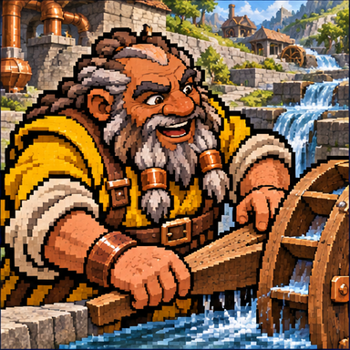

**Good · Personal traits:** Industrious, Expansive.

*Village millwrights take charge of inventions that workshops once rented by the hour.*

Bram was sent to retrieve a broken golem that had kept a village's mill turning. He rebuilt its mechanism as a chain of small waterwheels that any farmer could service, then taught the village to cast replacements. Guild owners still send him bills for every grain of flour they think would have passed through that golem's hands.

**Portrait direction:** Enthusiastic ingenuity. Palette: Citrine yellow jerkin, blue water and copper leather. Activity: Slides a wooden paddle into a small waterwheel

### Dessa Quartzbell — First of the Night Shift

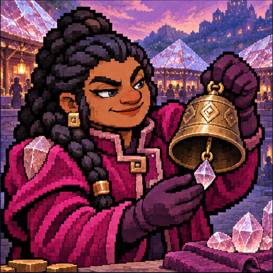

**Neutral · Personal traits:** Organized, Creative.

*Night workshops form a separate assembly with its own election hours and public works.*

Dessa automated a bell so workers below ground would hear the opening of the meeting that set their wages. When the masters moved the meeting to daylight, she moved the bell to the night market and invited everybody still awake. Her assembly votes beneath a quartz dome that used to be sealed after dusk.

**Portrait direction:** Wry defiance. Palette: Fuchsia coat, dusty quartz and midnight plum. Activity: Suspends a small faceted quartz clapper in a bell

### Nori Bondhammer — The Holder of the Keys

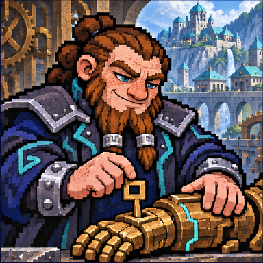

**Evil · Personal traits:** Financial, Arcane.

*A golem designer turns maintenance contracts into the power to stop a whole city.*

Nori sold his first golems cheaply after apprenticing under a master who could never get anyone to buy one. Every joint answered to a key only he could replace, and in time the public pumps all took the same locks. He is building a mint now so the people buying those keys will have somewhere to borrow their fee.

**Portrait direction:** Polite calculation. Palette: Midnight blue coat, turquoise sparks and pewter. Activity: Fits a peculiar square key into a small brass golem wrist

### Ulna Shaleprint — Caller of the Second Draft

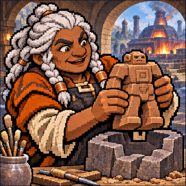

**Good · Personal traits:** Philosophical, Ingenuity.

*A mentor preserves discarded craft designs so young builders can challenge their masters.*

Ulna hauled rejected molds back to the gallery where trainees were allowed to practice. She put a number on each one and paid a prize for improving the molds their inventors insisted were perfect. The trainees set up their own guild the day she stopped charging visitors to look at what they made.

**Portrait direction:** Bristling curiosity. Palette: Burnt orange jacket, charcoal mold and cream sleeves. Activity: Raises a clay cast from its open stone mold with both hands

### Kedran Shieldpeg — Warden of the Ground Floor

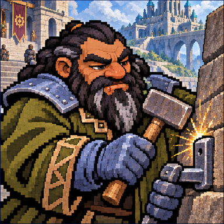

**Neutral · Personal traits:** Defender, Magic Resistant.

*A repair captain resists the practice of concentrating magical defenses in guild towers.*

Kedran discovered how far a broken protective seal could throw a cobblestone when one broke in his cellar. He mapped the streets that would be flattened if the guild towers failed, and their tenants began taking his inspections seriously. Even the tower masters now knock before stepping into a house that flies his mark.

**Portrait direction:** Guarded diligence. Palette: Olive felt, steel blue and mica gray. Activity: Hammers a steel anchor into a masonry seam

## Kuriotates

### Sereia Coil-of-Law — The Registrar of Peoples

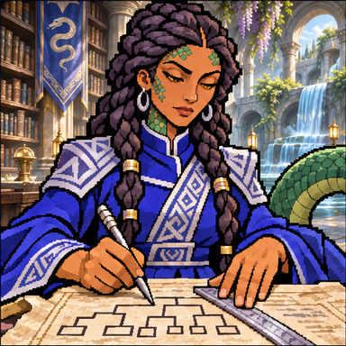

**Neutral · Personal traits:** Arcane, Organized. **Inherited:** Sprawling.

*A lamia administrator examines the uneasy boundary between accommodation and the confederacy's informal racial castes.*

Sereia was trained as a court mage but made her reputation rewriting contracts that assumed every citizen walked on two legs. Her registries gave lamia households, centaur companies, and human guilds enforceable places in the same administration. Those categories also hardened into rules about which peoples could hold which offices, a restriction she defends as the necessary scaffolding of peace. The officials who support her want the confederacy to survive an absent king, even if its citizens must fit more neatly into her ledgers.

**Portrait direction:** Exacting civic composure. Palette: Royal cobalt with silver accents. Activity: Drawing a branching registry diagram on a parchment map with a silver stylus while guiding a dividing ruler with the other hand.

### Torven Longstride — Voice of the Outer Roads

**Good · Personal traits:** Defender, Charismatic. **Inherited:** Sprawling.

*A centaur frontier commander gives the outlying settlements a political voice independent of the great cities.*

Torven spent twenty years defending settlements whose brightest children and richest harvests departed for the core cities. When an evacuation order abandoned three allied villages, he held the road until their people could follow. The villages elected him to carry a joint petition, and the centaur companies refused to replace him when the royal clerks dismissed it. He remains loyal to the confederacy, but insists that citizenship include the right to influence decisions made behind distant city walls.

**Portrait direction:** Weathered inclusive determination. Palette: Muted sage green with bronze accents. Activity: Binding several village ribbons together around a road spear's shaft, deliberately making one shared standard.

### Ilyra Roof-Singer — Captain of the High Quarter

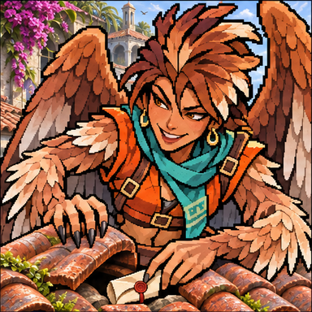

**Neutral · Personal traits:** Creative, Raiders. **Inherited:** Sprawling.

*An urban harpy faction brings the city above street level into politics, mixing civic culture with extralegal resistance.*

Ilyra organized the harpy messengers who nested above a city that taxed their deliveries but refused to recognize their homes. A landlord's attempt to tear down the high quarter became a week of vanished rent chests and mocking songs delivered through every upper window. Her couriers now protect rooftop markets, smuggle dissidents between districts, and maintain the fastest warning network in the confederacy. She bargains with the city below as its indispensable neighbor, never as its obedient ornament.

**Portrait direction:** Daring irreverent delight. Palette: Burnt orange with turquoise accents. Activity: Prying up a loose roof tile with one clawed hand while retrieving a hidden folded message with the other.

### Avar Senn — The Price of Welcome

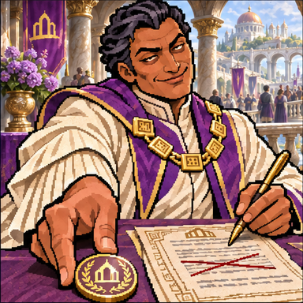

**Evil · Personal traits:** Financial, Organized. **Inherited:** Sprawling.

*An authoritarian merchant preserves the multiracial metropolis while making its promise of asylum a source of exploitation.*

Avar rose by supplying food and housing to newcomers whom the royal administration had welcomed faster than it could accommodate. He converted those emergency advances into hereditary obligations, then purchased offices that let him decide when a family had repaid them. His city admits almost anyone and displays every people of Erebus in its splendid public processions. Behind that hospitality, his magistrates make leaving one's assigned work far harder than entering the gates.

**Portrait direction:** Silken predatory hospitality. Palette: Warm ivory with imperial purple accents. Activity: Sliding a citizenship token toward the viewer while crossing out an exit clause in its contract with his other hand.

### Meren Glasshand — Advocate of the Unenchanted Oath

**Neutral · Personal traits:** Philosophical, Magic Resistant. **Inherited:** Sprawling.

*A civic skeptic questions rule by personal supernatural charisma without abandoning the confederacy's pluralism.*

Meren investigated a neighborhood magistrate who had used a charm to turn public consultations into unanimous acclaim. Exposure earned her a shattered hand and a new following among citizens uneasy about the court's almost religious reverence for its boy-king. Her assemblies require testimony outside magical influence and publish dissent beside the winning decision. She asks whether a people held together by one extraordinary ruler can learn to trust its ordinary disagreements.

**Portrait direction:** Cool defiant scrutiny. Palette: Charcoal gray with mint green accents. Activity: Pulling a censor's ribbon off an open public record with her articulated glass hand while spreading the pages with her living hand.

### Philia Copperroof — The Canopy Surveyor

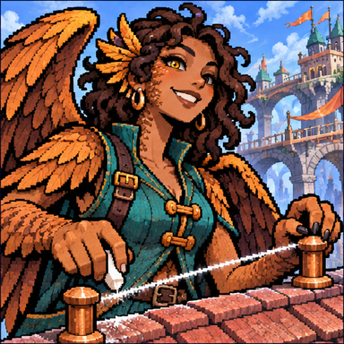

**Good · Personal traits:** Ingenuity, Defender. **Inherited:** Sprawling.

*Winged laborers claim public air routes through the towers they keep standing.*

Philia spent her first wages replacing a scaffold that humans could not reach and her fellow harpies were forbidden to land on. She kept the invoices and drew the first survey of all the roofs a city could not maintain without them. The workers now run the rooftop stations and keep a lane open even to people who cannot afford to fly.

**Portrait direction:** Cheerful assurance. Palette: Peacock teal vest, copper feathers and blue sky. Activity: Pulls a bright chalk line between two rooftop pegs

### Rython Twelvearches — First Speaker of the Covered Market

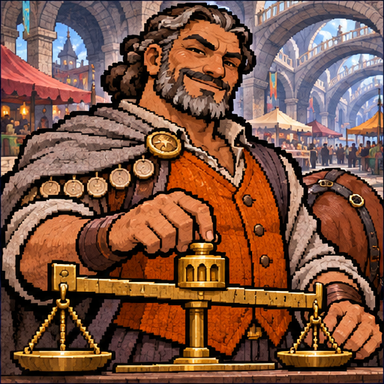

**Neutral · Personal traits:** Financial, Expansive. **Inherited:** Sprawling.

*Stallholders make their market an independent town built to fit every kind of body.*

A centaur's hooves once cracked the stairs to the market and Rython was charged for the damage although he was standing outside. He bought a sunken quarry and filled it with gentle ramps, high stalls and aisles wide enough for three bodies like his. He charges to cover the paving and lets even the people who sneered at it come in out of the rain.

**Portrait direction:** Shrewd welcome. Palette: Persimmon orange waistcoat, gray stone and chestnut leather. Activity: Slides a stamped weight along a balance beam

### Isil Coilbank — The Holder of the Deeds

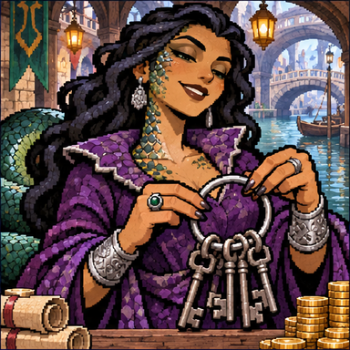

**Evil · Personal traits:** Organized, Arcane. **Inherited:** Sprawling.

*A deed broker coerces families whose homes stand on land built up by several peoples at once.*

Isil amassed deeds to the old riverbed while its lamia houses were still built on floats. When the river shifted inland, she charged the residents for the reclaimed foundations under their homes and took their boats as collateral. Her tenants are free to move, provided they leave their furnishings and a child who knows the ledger.

**Portrait direction:** Courteous avarice. Palette: Imperial purple gown, oxidized silver and dark green scales. Activity: Threads a ring of iron boat keys onto a split silver hoop

### Tevin Manywindows — Keeper of the Common Rooms

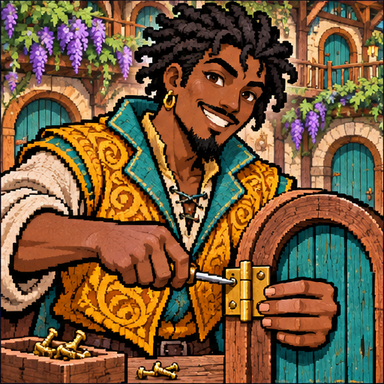

**Good · Personal traits:** Charismatic, Creative. **Inherited:** Sprawling.

*A mixed neighborhood writes civic law from the practical business of sharing buildings.*

Tevin inherited a boarding house whose forebears had added a door for each new kind of lodger. He took the doors out of the price of rooms and set up the first tenants' festival with the proceeds from the old hinges. Visitors still take the number of doors for a sign of disorder until they see who carries whom out in a fire.

**Portrait direction:** Social ease. Palette: Marigold vest, turquoise doors and cedar-brown beams. Activity: Seats a spare brass hinge onto a little wooden door frame

### Asen Curtainfall — Surveyor of the Last Street

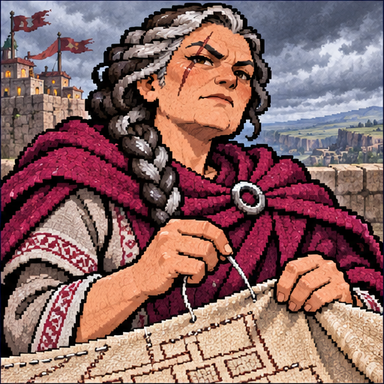

**Neutral · Personal traits:** Philosophical, Magic Resistant. **Inherited:** Sprawling.

*Outer settlements insist their right to exist cannot depend on a city's decision to extend its walls.*

Asen grew up in a settlement that vanished each time the capital commissioned a new map. She sewed her street onto the edge of the maps and offered the rest of the bolt to other villages missing from the survey. The patchwork hangs in her court because it takes a succession of people to carry it anywhere else.

**Portrait direction:** Plain-spoken stubbornness. Palette: Raspberry mantle, chalk linen and storm-gray ground. Activity: Stitches a corner of rough linen onto a large cloth plan

## Ljosalfar

### Saeril Reedkeeper — Steward of the Living Granaries

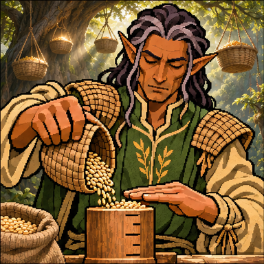

**Neutral · Personal traits:** Financial, Organized. **Inherited:** Dexterous.

*The material economy of a forest civilization: seed reserves, seasonal obligations, and the leverage of food.*

Saeril kept the seed exchanges between groves whose nobles considered accounting beneath an elf's dignity. When blight destroyed an autumn harvest, his unglamorous reserves fed households that the court's songs had not remembered to count. The groves accepted his common calendar of planting, loans, and repayment, giving their steward influence that neither birth nor magic had earned him. He now trades that influence for secure borders and favorable treaties, regarding a glorious war as a particularly wasteful kind of famine.

**Portrait direction:** Dry patient competence. Palette: Moss green with buff gold accents. Activity: Pouring seeds from a small reed basket into a calibrated wooden measure, checking the level with his free hand.

### Nethra Cinderbough — Architect of the Burnt Grove

**Good · Personal traits:** Defender, Ingenuity. **Inherited:** Dexterous.

*Reconstruction and skilled adaptation after forest destruction, rather than vengeance or royal ritual.*

Nethra returned from border service to find that a magical fire had spared her village's roots and destroyed nearly everything above them. She persuaded its survivors to build around the scarred trunks instead of abandoning them or demanding impossible restoration. Her bridges, cisterns, and sheltered nurseries made the damaged grove habitable while new growth slowly returned. Other burned communities now seek her leadership, and she measures victory by how many people can come home after the soldiers leave.

**Portrait direction:** Resilient practical hope. Palette: Copper rust with dark pine accents. Activity: Shaping a young bridge branch with a small drawknife, both hands pulling the blade carefully toward her.

### Iovain Stillroot — Herald of the Unbroken Summer

**Evil · Personal traits:** Spiritual, Expansive. **Inherited:** Dexterous.

*A cruel Seelie ecological absolutism, distinct from the Svartalfar court's intrigue and predation.*

Iovain tended a sacred grove through decades of rebuilding and came to regard every cleared field as another wound in the world's recovery. He began planting boundary trees across neighboring farms, preaching that the forest's return outweighed the claims of short-lived peoples. When hungry refugees cut those saplings for firewood, his followers drove them out and consecrated their abandoned houses as shrines. He offers the Ljosalfar an endless summer purchased by treating everyone beyond its shade as expendable.

**Portrait direction:** Serene ruthless conviction. Palette: Bone ivory with citron yellow accents. Activity: Pressing living roots into the cracked top of an old boundary stone, one hand forcing them downward while the other blesses the growth.

### Aelwen Many-Vows — Witness of the Short Years

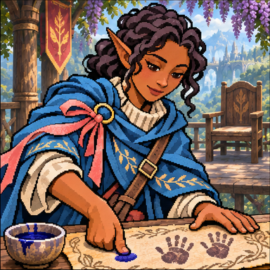

**Good · Personal traits:** Charismatic, Philosophical. **Inherited:** Dexterous.

*Elven longevity becomes an obligation to remember mortal allies rather than grounds for indifference to them.*

Aelwen was sent to renew a treaty and discovered that three generations of its human signatories had died while her court delayed an answer. She stayed to record their names and found that their descendants remembered elven silence more clearly than elven promises. Her traveling witnesses now carry the histories of mortal allies between groves, insisting that an oath cannot wait upon the convenience of the long-lived. Border households and younger elves have made her the voice of those who must share a world before they can afford to understand it.

**Portrait direction:** Earnest openhearted attention. Palette: Cerulean blue with coral pink accents. Activity: Pressing an inked thumb beside several old handprints on a treaty, steadying the parchment with her other hand.

### Namar Oathmolt — Keeper of the Quiet Boundary

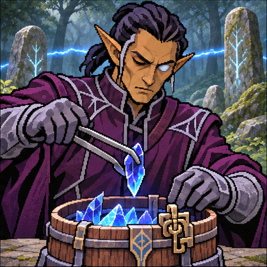

**Neutral · Personal traits:** Arcane, Magic Resistant. **Inherited:** Dexterous.

*A counter-enchanter protects the forest from benevolent and hostile magic alike, limiting even his own court's mages.*

Namar once strengthened the spells that encouraged a frontier grove to grow, until competing enchantments left its trees flowering and dying in the same week. Undoing the damage taught him to prize limits more than displays of power. His wardens now inspect foreign relics, royal experiments, and druidic blessings with the same suspicion, earning enemies among allies who believe good intentions should exempt them. Groves tired of becoming somebody else's magical answer support his austere promise that their seasons will remain their own.

**Portrait direction:** Austere vigilant restraint. Palette: Aubergine purple with cool gray accents. Activity: Lifting one dangerous crystal shard out of a containment hoop with long tongs while adjusting the hoop's ward clasp with his other hand.

### Calen Birdbranch — The Messenger of the Lower Boughs

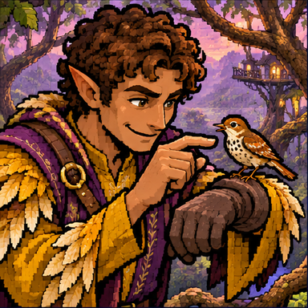

**Good · Personal traits:** Creative, Expansive. **Inherited:** Dexterous.

*Young settlements claim a voice through a relay that runs below the old canopy roads.*

Calen tended messenger birds that were trained to fly only to the manors in their breeding book. He let a clutch nest in a roadside willow and raised the fledglings to land where woodcutters offered a perch. The lord of the high branches still receives the news, a little later than the bark peelers.

**Portrait direction:** Suppressed excitement. Palette: Golden yellow tunic, lilac dusk and copper bark. Activity: Coaxes a small speckled bird onto a gloved wrist

### Mevara Rainsuture — Tender of the Root Bridges

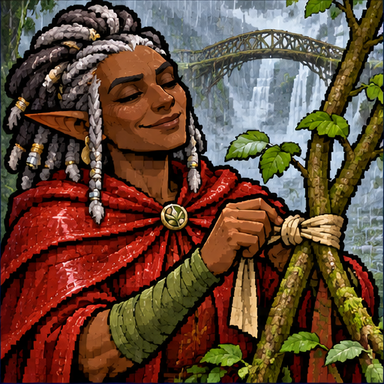

**Good · Personal traits:** Ingenuity, Defender. **Inherited:** Dexterous.

*Tree surgeons organize remote groves around the living crossings they maintain.*

When a flood took her bridge, Mevara followed its torn limbs downstream and transplanted the living ends. They took root on opposite banks within sight of an old ferry that had charged an armful of firewood to carry a child. Crossing dues in her new groves consist of watering a branch on the way past.

**Portrait direction:** Patient pride. Palette: Vermilion rain cape, moss and pearl-gray light. Activity: Knots a strip of cloth around two living branches to train them

### Thalan Ambervow — The Warden of First Growth

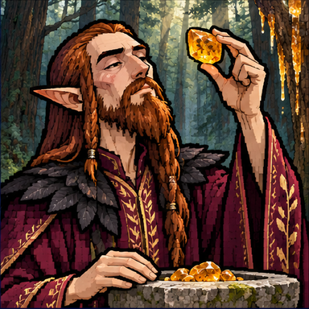

**Evil · Personal traits:** Spiritual, Organized. **Inherited:** Dexterous.

*A traditionalist appropriates woodland by giving ancient trees rights only his court can hear.*

Thalan was a witness when the oldest pine of his province fell across a boundary ditch. In the resin he claimed to read a deed covering both banks, then the houses and fields adjoining them. He invites any dispossessed farmer to attend the hearings, provided they can offer testimony in a language the court accepts from trees.

**Portrait direction:** Self-righteous calm. Palette: Wine violet robe, amber resin and forest black. Activity: Tilts an amber resin shard to the light above a shallow stone dish

### Finnel Woodmeter — The Tender of Coppices

**Neutral · Personal traits:** Financial, Industrious. **Inherited:** Dexterous.

*A licensed woodcutter earns protection for trees and wages for the people who harvest them.*

Finnel never felled a trunk he could return to in seven years and cut again. He taught the villages to count regrowth alongside their timber before the merchants could lay claim to it. His contracts infuriate the court because coppices are now worth enough that a worker can take a lord to court for stealing one.

**Portrait direction:** Exact satisfaction. Palette: Sky blue work coat, toasted bark and wheat. Activity: Checks the girth of a sapling with a loop of measuring tape

### Lethiel Hollowtone — The Constant Root

**Neutral · Personal traits:** Arcane, Philosophical. **Inherited:** Dexterous.

*A researcher gives every grove access to warnings once reserved for the oldest families.*

Lethiel suspected the humming that preceded a blight came from ordinary roots rather than a family spirit. She sank hollow tubes at each farm and invited the youngest worker to tell her the note before the family elders could interpret it. A ring of groves now reports to her when the note changes, sometimes in time to cut a branch and save a valley.

**Portrait direction:** Absorbed attention. Palette: Ivory robe, cypress shadows and pink quartz. Activity: Lowers a hollow rosewood pipe into a root cavity

## Khazad

### Brunna Chalkvein — Warden of the Open Shelter

**Good · Personal traits:** Defender, Organized.

*Dwarven caution serves public refuge and disaster preparation, rather than royal authority or mercantile expansion.*

Brunna commanded a mine rescue when a spring thaw flooded workings that three feuding clans each claimed were another's responsibility. She cut through a private vault wall to reach the trapped crews, then submitted herself to the compensation court beside the people she had saved. The settlement established a common emergency fund and gave its administration to her. Her shelter towns admit outsiders during disasters under strict inventories and shared duties, making measured trust a matter of engineering rather than sentiment.

**Portrait direction:** Commanding reassuring urgency. Palette: Vermilion red with cream accents. Activity: Swinging a bronze alarm bell outward with one hand while directing an evacuation with a decisive open-palmed sweep of the other.

### Dorrik Ledgergrave — Assayer of Lives

**Evil · Personal traits:** Financial, Philosophical.

*A Khazad moral philosopher twists the vault's promise of security into a doctrine that prices people by their assets.*

Dorrik began as an arbitrator asked to decide how much a collapsed mine owed its dead workers' families. His tables of compensation became a general theory that a person's claim to protection should equal the wealth they preserved for the hold. Rich clans endowed his school, while debtors found that even an honest accident could reduce their descendants' standing. His creditor faction keeps full vaults and orderly streets by making poverty evidence that a dwarf deserves less of both.

**Portrait direction:** Grave pitiless calculation. Palette: Midnight blue with old gold accents. Activity: Placing a tiny worker figurine on one pan of a balance while adding gold weights to the other, scrutinizing the result.

### Helvi Handseer — Carver of the Unrecorded

**Neutral · Personal traits:** Spiritual, Creative.

*The runewarden tradition and contested ancestral memory, including the histories prestigious clans would erase.*

Helvi lost her sight after years reading the ancestral pillars by candlelight and learned the old runewardens' art of knowing a history by touch. While restoring a damaged hall, she found that the names of banished kin had been chiseled away beneath an approved account of their disgrace. She carved those names into a new pillar without pretending their owners had been innocent. Smaller clans now gather behind her demand that the Khazad preserve the whole record, even when remembrance threatens a useful peace between powerful families.

**Portrait direction:** Solemn tactile patience. Palette: Pale lavender with earth ocher accents. Activity: Chiseling a rune into a stone tablet while tracing the preceding carved line with the fingertips of her other hand.

### Ordan Outledge — Captain of the Unclaimed Pass

**Neutral · Personal traits:** Expansive, Raiders.

*Landless dwarves and mobile prospecting companies challenge the assumption that security begins with an established hold.*

Ordan's family returned from prospecting to discover that their clan had sold its marginal homes to settle a larger house's debt. He gathered other dispossessed crews into a caravan that opened abandoned passes and lived from salvage, surveys, and armed escort. When neighboring lords imposed tolls, his companies seized the tollhouses and offered the same roads to everyone who paid for their upkeep. He seeks enough land to found a hold, but his followers fear that becoming respectable will mean shutting the gates on people like themselves.

**Portrait direction:** Restless scrappy confidence. Palette: Leather umber with crimson accents. Activity: Setting a survey compass on a mountain map and scratching a new pass route into it with a short iron point.

### Sovna Trueweight — Keeper of the Public Scale

**Good · Personal traits:** Magic Resistant, Financial.

*The historical trauma of magical fraud produces transparent standards for outsiders, rather than isolation or retaliatory cheating.*

Sovna trained as an assayer in a hold where an illusory shipment had ruined three generations of one family. Instead of forbidding foreign trade, she built testing rooms where dwarf and stranger could watch the same metal weighed, scratched, and checked against enchantment. Her publicly recorded standards attracted merchants excluded by clan monopolies and gave honest small traders a way to challenge richer rivals. The market towns have chosen her to lead them because she treats distrust as a problem to solve before a bargain, rather than a debt to collect afterward.

**Portrait direction:** Candid meticulous assurance. Palette: Emerald green with clean white accents. Activity: Rubbing a coin across a black touchstone while pointing to its fresh metal streak with her other hand for an unseen customer.

### Berga Ironwedge — First Hand of the Rescue Crew

**Good · Personal traits:** Defender, Ingenuity.

*A rescue brotherhood makes unsafe holds answer to the people who shore them up.*

Berga's crew came to a collapsed adit with orders to save the ore chests before the men. She wedged the chests under a crack and hauled out enough witnesses to overturn the order in court. The holds that ignored the judgment still keep their pit bosses, but each deep crew carries a copy of her rescue charter.

**Portrait direction:** Composed urgency. Palette: Safety orange coat, basalt and pale oak wedges. Activity: Taps a pale wooden wedge into a timber prop

### Orik Cinderhall — The Last Voice at the Smelter

**Neutral · Personal traits:** Industrious, Organized.

*Smelter crews pool warmth, housing and credit away from the gold vaults.*

Orik wanted to know why his apprentices froze upstairs while his slag boiled beneath their feet. He rerouted the waste heat through a row of affordable apartments before the hold's surveyors found out. The families bought the next furnace themselves and sent him to bargain for the mountain's water.

**Portrait direction:** Determined grit. Palette: Prussian blue coat, flame orange and smoky gray. Activity: Twists a heavy stopcock on a copper heating pipe

### Huldra Sevenvault — The Keeper of Quiet Interest

**Evil · Personal traits:** Financial, Philosophical.

*The owners of sealed vaults collect rents even from holds unable to reach their own deposits.*

Huldra bought a vault that had been locked since an earthquake and leased the idea of the gold within it to desperate holds. She offered to forgive any hold that opened the vault, so long as it signed over its rights to the gold if it failed. Now that seven tunnels have collapsed in the attempt, her creditors prefer to keep paying and let the door remain a matter of faith.

**Portrait direction:** Refined malice. Palette: Mulberry velvet, polished steel and vellum beige. Activity: Turns a heavy vault combination wheel one notch

### Garum Veinwalker — Voice of the Surface Consuls

**Good · Personal traits:** Charismatic, Expansive.

*Surface Khazad establish ports and trading farms with the same rights as underground holds.*

Garum returned from shipping season with grain, new words and a wife who had never seen a vault. The keepers assigned them a cellar outside the gates, so he made it a warehouse and invited the coast hands to live nearby. The first surface consul was elected in that cellar with the shutters open.

**Portrait direction:** Neighborly conviction. Palette: Jade green waistcoat, cream canvas and bronze light. Activity: Hauls a cloth grain sack onto a wooden counting ledge

### Ursi Mothsilver — Finder of Lost Silver

**Neutral · Personal traits:** Magic Resistant, Creative.

*A silverworker discovers why older galleries are empty and makes their lost work available to independent holds.*

Ursi followed a tarnished thread into a shaft where all the assay marks had been chiseled away. She strung salvaged silver together by the sequence of tool marks and found a generation of makers the vault families never recorded. Neighboring holds send her strips of their own silver to see whose work she can name.

**Portrait direction:** Bright absorption. Palette: Ice mint wool, white silver and plum shadows. Activity: Feeds a ribbon of etched silver through a handheld loupe

## Sidar

### Velisar — The Last Witness

**Good · Personal traits:** Philosophical, Creative.

*An immortal witness who spends the Sidar's accumulated memory on justice outside their borders.*

Velisar became a shade to remember the names of a village that a victorious king ordered struck from every chronicle. Centuries later, she discovered that she could recall its tax rolls perfectly but no longer remember her sister's laugh. She now leads a company of witnesses who record testimony before fading can empty it of feeling, and brings their records into foreign courts even when Sandalphon's seclusion would be safer.

**Portrait direction:** Patient moral attention. Palette: Ochre gold and ink blue. Activity: Inscribing a witness statement into a wax tablet with a short stylus, her other hand flattening the tablet on a desk

### Nemeia — The Thread-Counter

**Neutral · Personal traits:** Organized, Financial.

*Patient commerce and contractual memory instead of isolation or military guardianship.*

Nemeia was a mortal factor hired to settle debts whose Sidar creditors had forgotten why they were owed. She learned to translate a shade's century-long patience into leases, warehouses and quiet purchases along the roads beyond the mist. Her trading houses now provision several hidden cities, and the shades accept her leadership because she alone can tell them which obligations still belong to the living.

**Portrait direction:** Dry contractual precision. Palette: Deep plum and antique brass. Activity: Threading two strands of a knotted credit cord through a brass reckoning ring with both hands

### Orven — Of the Open Door

**Good · Personal traits:** Charismatic, Expansive.

*The living inhabitants of Sidar cities claim a political voice while retaining their immortal neighbors.*

Orven kept the ferry to a hidden Sidar city long after its immortal council stopped noticing the villages on the opposite bank. When a flood drove those villagers to his landing, he opened the passage and housed them in districts that had stood empty for generations. The mortal households made him their speaker, and he persuades the Grey that a city can shelter new lives without surrendering the old ones it preserves.

**Portrait direction:** Welcoming working strength. Palette: River teal and warm cream. Activity: Turning the iron crank of a ferry winch while reaching out to steady an arriving passenger

### Satha — Stillglass

**Evil · Personal traits:** Arcane, Defender.

*The wish to preserve a hidden city hardens into the coercive preservation of its inhabitants.*

Satha once painted portraits so that newly faded shades could remember the faces they had surrendered. After raiders burned her gallery, she enclosed her district behind wards that admitted neither fire nor uninvited travelers. Her followers call it the safest place in Erebus, but she now forbids residents to leave and treats every change of loyalty, trade or family as damage to a collection entrusted to her care.

**Portrait direction:** Possessive perfect stillness. Palette: Frost lilac and polished silver. Activity: Painting one violet ward-stroke across the edge of a portrait miniature with a fine brush

### Terev — The Unfinished

**Neutral · Personal traits:** Industrious, Raiders.

*A restless artisan sends Sidar retrieval expeditions into the world rather than waiting within it.*

Terev chose fading so that death could never interrupt the mosaic he had spent half his life assembling. He returned from seclusion to find its missing panels displayed as trophies in the halls of three foreign dynasties. His fellow dispossessed artisans furnish a small army that steals their works back, while his refusal to ask who now treasures those works keeps restitution perilously close to conquest.

**Portrait direction:** Restless unfinished obsession. Palette: Oxblood red and turquoise. Activity: Pressing a turquoise tessera into a missing mosaic panel while scraping mortar with a narrow trowel

### Naresh Lintelmist — The Porter at Noon

**Good · Personal traits:** Charismatic, Defender.

*A border porter negotiates daylight passage for shades and their mortal relations alike.*

Naresh kept a toll station where travellers could shelter from the hour the shades were most visible. He repaired the shutters after every raid, leaving one unlatched for people who could no longer grasp the handle. Ordinary travellers now leave their names at the station beside the shades they still recognize.

**Portrait direction:** Reassuring courtesy. Palette: Moss green brocade, smoke and burnished brass. Activity: Lifts a wooden shutter latch with two fingers

### Maelis Frostlinen — The Weaver of the Missing Years

**Neutral · Personal traits:** Creative, Philosophical.

*Retired shades piece together the years they no longer remember without selling them to collectors.*

Maelis began weaving dates into the strips she used to bind her winter clothes. Other shades brought her a loose end here and there, most of them as eager to forget it as to have it recorded. Her workshop keeps the resulting cloth folded so a visitor can ask for just the year she wants to see.

**Portrait direction:** Attentive reserve. Palette: Dusty pink dress, moonlit ivory and fog gray. Activity: Passes a small shuttle across a loom of pale bands

### Soren of the Span — The Toll on Vanished Things

**Evil · Personal traits:** Financial, Arcane.

*A crossing broker charges shades memories when service no longer has another cost.*

Soren built a bridge broad enough for the dead to cross without brushing the living. He began the toll with a coin and later agreed to accept an image the traveller could bear to lose. People cross more often now because he cannot collect the full fee from anyone who remembers what he first promised.

**Portrait direction:** Patient cupidity. Palette: Royal purple robes, blue smoke and pewter. Activity: Tips a small glass phial of luminous blue mist into a weighing bowl

### Iram Stonepause — Mason of the Slow Stair

**Neutral · Personal traits:** Industrious, Organized.

*A mason lets shades and mortals build the same road on different schedules.*

Iram inherited a stair that was renewed every forty years by workers who did not live to see it finished. He carved a channel to take each course's weight before the next crew arrived, then invited the shades who had laid the lowest courses to check his work. The stair was finished in his lifetime, and the patches keep his apprentices employed in the next one.

**Portrait direction:** Practiced patience. Palette: Sienna orange work smock, dolomite gray and faint lime. Activity: Lays a small slate shim under a stair tread

### Veda Secondwindow — The Hush of the Dayroom

**Good · Personal traits:** Expansive, Magic Resistant.

*One household teaches families to recognize shade kin by familiar routines.*

Veda kept a room with the blinds open for her brother after he began to fade. He stopped recognizing the street, but his hand always found the window catch he had repaired as a boy. Her dayrooms now leave the things their visitors remember in reach and ask living guests to go home without carrying them away.

**Portrait direction:** Tender steadiness. Palette: Muted ultramarine shawl, sky gray and blond wood. Activity: Opens a familiar worn brass window catch

## Lanun

### Maris Tallow — Keeper of the Lights

**Good · Personal traits:** Defender, Organized.

*Lighthouse keepers and harbor pilots build maritime authority around safe passage.*

Maris lost her first ship because two rival captains extinguished a harbor beacon to settle a wager. She bought the ruined tower with her salvage share and persuaded neighboring keepers to answer one another's signals regardless of which flag approached. Their pilots and escort captains now follow her compact of safe passage, giving her a coast to govern and a difficult promise to keep when an enemy asks for rescue.

**Portrait direction:** Unsentimental rescue vigilance. Palette: Saffron yellow and storm navy. Activity: Rotating the shutter wheel of a signal lantern while shielding its flame with her other hand

### Orrick — The Sounder

**Neutral · Personal traits:** Philosophical, Arcane.

*The Lanun explore and study the changed sea instead of mastering it through piracy or surrendering to it.*

Orrick inherited an Aifon chart that marked a thriving city where his lead line found only open water. He began paying divers and conjurers to measure the currents, ruins and strange voices that other captains dismissed as bad omens. His survey flotilla follows him for shares in each discovery, although he has started recording dreams that predict soundings he has never taken.

**Portrait direction:** Fascinated sleepless inquiry. Palette: Emerald green and copper rust. Activity: Paying out a weighted sounding line over a ship rail while marking its wet depth on a slate with chalk

### Sella — Nine Shares

**Neutral · Personal traits:** Creative, Financial.

*Lanun freedom expressed through a fleet of fiercely contractual shareholders and floating markets.*

Sella won nine shares in a captured vessel by carving its new figurehead from the wreckage of her own boat. Rather than sell them, she divided their profits among shipwrights, cooks and musicians who could make the vessel earn between raids. Her floating markets have grown into a fleet whose crews elect her captain each season, provided the accounts balance and the next voyage promises something worth seeing.

**Portrait direction:** Entrepreneurial craft delight. Palette: Bright magenta and warm cream. Activity: Carving a curling wooden wave into a ship figurehead with a hooked gouge while bracing it with her other hand

### Brannoc Blackwake — The Answered Captain

**Evil · Personal traits:** Spiritual, Summoner.

*A collective of captains turns the sea's unanswered prayers into an exploitative pact with the Overlords.*

Brannoc prayed over a becalmed fleet until something beneath it answered in the voices of the drowned. He returned with full holds and taught desperate captains the offerings that would bring the same favor. They now entrust him with their voyages and their prisoners, while he insists that every sailor carried away by the answering tide has merely been promoted to a deeper service.

**Portrait direction:** Serene drowned devotion. Palette: Salt black and spectral seafoam. Activity: Pouring black salt from an open shell into a foaming ritual basin while tracing a circle above it

### Ilyra Rope-End — The Unbought

**Good · Personal traits:** Charismatic, Raiders.

*A privateer coalition makes the Lanun love of freedom apply to captives as well as captains.*

Ilyra learned rigging while chained aboard a prize ship and escaped by dropping its entire mainsail onto the boarding party that had come to sell her again. The freed rowers chose her to command their stolen vessel, and other escaped crews soon joined it. She finances their war on slave galleys by taking the cargo of any captain who trades in people, a rule that has cost her lucrative allies and earned her fiercely loyal harbor towns.

**Portrait direction:** Fierce liberating resolve. Palette: Vermilion red and indigo. Activity: Slicing a captive sailor wrist-binding with a short boarding knife, carefully pulling the rope clear with her other hand

### Dario Reefglass — Pilot of the Shifting Bar

**Neutral · Personal traits:** Financial, Philosophical.

*A harbor pilots' league takes charge of the shoals the admirals keep sailing through.*

Dario learned to read silt by looking through the neck of a broken bottle a freebooter left behind. He warned three captains away from the bar the week the harbor lord's own ship went down. The pilots who inherit his bottle earn a berth each year by bringing at least one rival's ship safely home.

**Portrait direction:** Lively scrutiny. Palette: Bright turquoise coat, bottle green glass and gray waves. Activity: Tilts a thick green lens to examine a sample of cloudy seawater

### Makena Saltstitch — Admiral of the Dry Dock

**Good · Personal traits:** Industrious, Organized.

*The caulkers' guild supports free sailors by holding title to the dock that services their ships.*

Makena scraped the governor's crest off a wreck and built the dock's doors out of its stern. The governor's creditors sued for the doors and found every crew in the harbor had bought a share in them. Warships still dock there, though their captains must wait while the smallest fishing boats come in first.

**Portrait direction:** Direct good humor. Palette: Signal yellow oilskin, walnut planks and cobalt water. Activity: Mallets a strand of oakum into a plank seam

### Carlon Mirrorsail — Prince of the False Harbor

**Evil · Personal traits:** Raiders, Creative.

*A wreckers' chief turns the stranded into labor for his uncharted piers.*

Carlon survived a wreck on a coast where lights were supposed to show safe water. He spent his compensation on brighter lamps and bribed the surveyors to take his stretch of cliff off their charts. The colony that strips the stranded ships has enough timber for houses and too much rope for most of its workers to leave.

**Portrait direction:** Cold showmanship. Palette: Carmine red brocade, lamp cream and storm charcoal. Activity: Rotates the shutter on a square signal lantern

### Hessa Sabletide — The Uncrowned Diver

**Good · Personal traits:** Expansive, Magic Resistant.

*A salvager bands divers together against vessels that claim everything on the bottom.*

Hessa cut loose a divers' bell the admiralty had declared lost while two men were still shut inside it. She entered the salvage award in their names and used her own share to buy communal lines and floats. The crews who train with her are trying to put the same bell to work on a shipwreck the admiralty has refused to admit is there.

**Portrait direction:** Quick confidence. Palette: Verdigris green diving vest, sea blue and cream rope. Activity: Clips a brass safety ring onto a coil of wet rope

### Jeron Foghorn — The Morning Between Storms

**Neutral · Personal traits:** Spiritual, Arcane.

*Crews from rival ports grant safe passage to a weather reader whose forecasts their temples usually suppress.*

Jeron kept watch for a storm his ship's priest had said would come only if somebody broke a vow. Every ship that followed his forecast instead survived, and the rest of the crews left him their instruments. He moors between hostile ports so that none of them can claim the weather belongs to its god alone.

**Portrait direction:** Faraway concentration. Palette: Mauve cowl, brass tubes and silver fog. Activity: Rotates the sliding drawtube of a brass weather glass

## Grigori

### Hadrin — The Ash-Baker

**Good · Personal traits:** Expansive, Industrious. **Inherited:** Agnostic.

*The civilian labor that sustains a land of adventurers becomes a source of leadership in its own right.*

Hadrin followed adventuring companies with a portable oven and learned that every heroic rescue left hungry people behind it. After a dragon burned a frontier town, he rebuilt its mill before anyone could agree whose statue should stand in the square. Settlers and retired adventurers now follow his workshops along the border, where his authority rests on roofs, bread and the stubborn belief that ordinary work deserves its own songs.

**Portrait direction:** Patient ordinary heroism. Palette: Burnt orange and flour cream. Activity: Scoring the surface of a large unbaked loaf with a small dough knife before sliding it into an oven

### Dessa Venn — The Unlicensed Muse

**Neutral · Personal traits:** Creative, Philosophical. **Inherited:** Agnostic.

*Secular culture tests Cassiel's ideas through art, including criticism of Cassiel himself.*

Dessa fled a royal theater after refusing to rewrite a lost battle as a god's deliberate triumph. In the Grigori cities she found audiences willing to laugh at immortals, then alarmed her patrons by giving Cassiel the least flattering part in her next play. Actors, teachers and disputing societies have made her their speaker, and she defends their right to question even the principles that first gave them refuge.

**Portrait direction:** Incisive theatrical mischief. Palette: Royal violet and amber gold. Activity: Pulling a heavy theater curtain aside with one hand while giving a precise two-finger cue to unseen actors

### Ruvik — The Red Wager

**Evil · Personal traits:** Charismatic, Raiders. **Inherited:** Agnostic.

*A mortal supremacist twists freedom from divine masters into the right of powerful mortals to dominate others.*

Ruvik became famous for killing a priest's summoned champion and refusing the grateful village's offer of a shrine. He taught his growing band that no god could own a mortal, then declared that a mortal should own whatever strength allowed him to keep. Disaffected adventurers and ambitious frontier captains now acclaim him, while the settlements beneath his protection discover that his contempt for divine tribute does not extend to tribute paid to him.

**Portrait direction:** Courteous predatory ambition. Palette: Burgundy wine and polished black. Activity: Pushing a carved cavalry marker across a campaign board while pinning a stack of tribute coins beneath his other palm

### Nallia Bronzebound — Warden of the Uncharmed Gate

**Good · Personal traits:** Magic Resistant, Organized. **Inherited:** Agnostic.

*Grigori independence becomes a practical institution protecting consent against magical coercion.*

Nallia was a border magistrate when an enchanted witness condemned three innocent refugees. She spent her inheritance learning how to recognize compulsions and training guards who could resist them. Her wardens now administer sanctuary gates for several towns, admitting pilgrims as people while refusing any priest or mage the power to speak another person's consent.

**Portrait direction:** Calm protective scrutiny. Palette: Cobalt blue and bright brass. Activity: Using bronze tongs to lower a fractured enchantment amulet into an open iron evidence box

### Edren — Twice Buried

**Neutral · Personal traits:** Arcane, Summoner. **Inherited:** Agnostic.

*An adventurer treats summoning as a mortal craft for hazardous exploration, without priestly patronage.*

Edren survived two collapsed tombs by sending conjured creatures where a living companion would have died. He returned to the Grigori with treasure, a missing hand and a determination to replace heroic last stands with better preparation. His expedition lodges elect him to direct their ventures, though their increasingly elaborate conjurations raise the question of how much danger can be delegated before courage becomes someone else's burden.

**Portrait direction:** Wry calculated daring. Palette: Bright turquoise and charcoal. Activity: Tracing a glowing geometric doorway in the air with his prosthetic index finger while steadying a broken archstone with his live hand

### Tessa Inkclasp — Mistress of the Cheap Press

**Good · Personal traits:** Creative, Ingenuity. **Inherited:** Agnostic.

*Print shops give displaced adventurers and minority sects a way to publish their own accounts.*

Tessa set her first type from lead she scavenged in a shrine the congregation had abandoned. She printed the survivors' account of its burning for less than the price of the priest's official version. The presses that learned from hers have turned the market's broadest street into a place where every lie has to compete for paper.

**Portrait direction:** Mischievous conviction. Palette: Cerise red waistcoat, tan paper and charcoal iron. Activity: Pulls the lever of a small hand printing press over a blank sheet

### Dowen Campbridge — Speaker for the Returning Companies

**Neutral · Personal traits:** Organized, Charismatic. **Inherited:** Agnostic.

*Former adventurers use camp courts to settle claims that city judges find inconvenient.*

Dowen spent a decade dividing salvage between people who came back from the expedition and the families of those who did not. He made a rule about whose turn it was to talk and kept his camp open whenever a judge refused to hear a case. His court handles less patrol pay these days than quarrels over orchards, alleys and absent children.

**Portrait direction:** Sociable patience. Palette: Pea green greatcoat, rust leather and river gray. Activity: Spreads a cloth bundle of old expedition tokens across a plank table

### Irena Dregs — The Price of Plain Water

**Evil · Personal traits:** Financial, Expansive. **Inherited:** Agnostic.

*A brewers' cartel takes advantage of a popular suspicion of magically treated water.*

Irena diluted the town's suspect well water with her own, expecting the council to reimburse her. When it refused, she bought the well rights and stopped telling her customers which water had been treated. Her settlements are prosperous enough to get every child a fresh cup, so long as its parents can keep up with the subscription.

**Portrait direction:** Proprietary amusement. Palette: Grape velvet, bottle greens and copper tubing. Activity: Secures a copper spigot to the side of a stoneware vessel

### Gavren Rook — Warden of the Common Stacks

**Good · Personal traits:** Philosophical, Defender. **Inherited:** Agnostic.

*Librarians keep evidence of their neighbors' religions available in a nation formally estranged from the gods.*

Gavren inherited six chests of confiscated books and explicit instructions to burn them in public. He burned the chests and moved the contents to any household willing to lend them again. When a magistrate complained that he was running a shrine, he offered to put the complaint in circulation beside the rest of the holdings.

**Portrait direction:** Generous irony. Palette: Pumpkin orange waistcoat, dark green shelving and parchment. Activity: Fits a thick book into a framed wall slot

### Mara Bentnail — Captain of the Salvage Road

**Neutral · Personal traits:** Raiders, Magic Resistant. **Inherited:** Agnostic.

*Independent salvagers insist owners prove they can render dangerous ruins safe before charging for access.*

Mara found a set of nail marks beside the spells that had made a collapsed tower impassable. She showed her crew how to recognize the safe route and marked every unclaimed chamber they freed. The city's owner sent a revenue guard and discovered someone had nailed his deed to the door of the one room she still refused to open.

**Portrait direction:** Clear-eyed nerve. Palette: Steel blue vest, oxidized tin and copper hair. Activity: Bends an iron nail against a small portable anvil with pliers

## Hippus

### Ulsha — The Marekeeper

**Good · Personal traits:** Expansive, Spiritual. **Inherited:** Horselord.

*The older Hippus culture of husbandry and sacred obligation offers an alternative to measuring a clan by its contracts.*

Ulsha inherited the ceremonial herd that her clan had kept through the Age of Ice, including mares too old to ride. When a hungry war captain ordered them slaughtered, she led the herd away and shared its young stock with families whose mounts had been requisitioned. Those families follow her grazing circuit and its rites of thanks, forming a confederacy whose riders owe service to the herd's survival before any employer's purse.

**Portrait direction:** Tender ancestral authority. Palette: Moss green and ivory wool. Activity: Braiding a horsehair strand and a bone bead into a grey mare forelock with both hands

### Hest Varrow — The Unbroken Relay

**Neutral · Personal traits:** Organized, Defender. **Inherited:** Horselord.

*Hippus speed creates a network of couriers whose political power depends on remaining trustworthy across wars.*

Hest first earned a captain's pay by carrying a peace offer through three armies that each wanted it to arrive too late. He built a chain of remount stations whose riders swear to deliver a sealed message without asking who profits from it. The station clans chose him to settle their disputes, and he now defends a growing strip of neutral roads against employers who believe that buying a courier should also buy the news.

**Portrait direction:** Watchful professional urgency. Palette: Mustard yellow and midnight navy. Activity: Fastening a sealed dispatch cylinder onto a saddle harness with both gloved hands before departure

### Cevran — The Dustreader

**Neutral · Personal traits:** Arcane, Creative. **Inherited:** Horselord.

*Descendants of Patria's mage-hunters reclaim magic as a Hippus art rather than accepting it as a foreign replacement for horses.*

Cevran's clan remembered every mage its ancestors helped Kylorin bring down, but none of the spells those enemies had taught their captives. He pieced those scraps of learning together with riders' weather lore and began shaping harmless dust figures to teach children the old battles. Young riders now gather beneath his painted banners to study a magic that travels with the herd, while traditional captains fear he is rebuilding the very dependence their ancestors escaped.

**Portrait direction:** Playful inherited defiance. Palette: Sky blue and sun gold. Activity: Sweeping one hand through airborne dust to shape a galloping horse while conducting its stride with two raised fingers of his other hand

### Ereska Stonecorral — The Winter Host

**Neutral · Personal traits:** Industrious, Organized. **Inherited:** Horselord.

*Permanent remount towns and the people left behind by campaigning riders become a Hippus political faction.*

Ereska built stone windbreaks around a winter camp after losing half its foals to a storm while the clan's warriors served abroad. Saddlers, smiths and grazing families stayed to enlarge the camp into a town, then built another where the next remount road ended. She commands their militia and supplies their cousins' companies, insisting that a people can keep its horsemanship without requiring every home to fold into a saddlebag.

**Portrait direction:** Grounded winter determination. Palette: Terracotta red and cool steel. Activity: Striking a hot horseshoe on an anvil with a hammer while gripping it securely in long tongs

### Marruk — The Debtbrand

**Evil · Personal traits:** Financial, Raiders. **Inherited:** Horselord.

*The mercenary contract becomes a machinery of perpetual debt and predatory intervention.*

Marruk discovered that bankrupt cities could still pay a company in pasture rights, hostages and the next season's harvest. He bought the unpaid contracts of other captains and sent their riders to collect, turning one failed campaign into a chain of dependent towns. His creditors' league now offers protection at prices designed never to be repaid, and its riders call every punitive raid the enforcement of an honest bargain.

**Portrait direction:** Polite acquisitive cruelty. Palette: Ivory silk and malachite green. Activity: Stamping a broad wax debt seal onto a harvest contract while sweeping grain counters into his own bowl with the other hand

### Parna Dawnrein — Speaker for the Unridden

**Good · Personal traits:** Expansive, Charismatic. **Inherited:** Horselord.

*Herders bargain collectively with commanders who think the herd's labor is free.*

Parna kept count of the mares left behind when a chief made each household supply a second mount. She withheld the foals the next year and taught the other herders to quote a price for all the work between one campaign and another. A new company gets pasture from her only after one of its officers spends a season working with the mares.

**Portrait direction:** Friendly insistence. Palette: Burnished honey wool, sage grass and cream. Activity: Braids a fresh cord into a working halter

### Bekar Windstitch — The Saddle That Fits

**Neutral · Personal traits:** Industrious, Ingenuity. **Inherited:** Horselord.

*Saddlers build a standing trade across camps that rarely stay in the same place.*

Bekar rode with thirteen companies trying to learn why each one wore out the same seam. He designed a saddle whose parts any rider could exchange at his wagon, then made the wagons exchange parts with each other. Stocks of Bekar's bolts are now a better measure of a camp's wealth than the splendor of its tents.

**Portrait direction:** Inventive concentration. Palette: Dusky orange work coat, wine leather and storm sky. Activity: Draws a blunt needle through the leather edge of a saddle

### Nessa Redscrip — Mistress of the Standing Retainer

**Evil · Personal traits:** Financial, Aggressive. **Inherited:** Horselord.

*A paymaster builds a permanent regime out of soldiers' short-term loyalty.*

Nessa offered to pay the winter wages of a company whose employer had fled. She paid in leather scrip redeemable at her own corrals and gave the officers twice as much when they seized the nearest crossing. In spring they found the retainer had no end date and the ford no road outside her accounting.

**Portrait direction:** Forceful confidence. Palette: Crimson brocade, horsehide beige and dark iron. Activity: Clips a single hole through a stiff leather pay token

### Oralun Hailward — The Truce at Foaling Hill

**Good · Personal traits:** Defender, Spiritual. **Inherited:** Horselord.

*Riders make foaling country a refuge even when rival clans meet elsewhere in battle.*

Oralun lost the mare that had carried him through six engagements when two camps fought over the only sheltered ground. He dug a trough there and swore to turn his bow on the first rider who crossed it armed. The elders still complain about that oath while sending their own mares to graze within its terms.

**Portrait direction:** Grave tenderness. Palette: Petrol blue wool, blue-gray sky and silver bronze. Activity: Pours fresh water from a skin over the rim of a stone trough

### Sedi Horsethistle — Master of the Mare's Mile

**Neutral · Personal traits:** Creative, Raiders. **Inherited:** Horselord.

*A race steward develops an alternative route to rank for riders without noble blood.*

Sedi's first mare outran her captain's horse on road work and was sold away before she could enter a race. She left the company with the next horse and timed an unsanctioned mile along every ford their riders used. Rich camps send their favorites to win her ribbons and sometimes have to buy the winner a coat to wear at the feast.

**Portrait direction:** Brisk delight. Palette: Bright violet jacket, light turquoise piping and dun ground. Activity: Drops a striped starter's pennant from an outstretched hand

## Amurites

### Nesra Vell — Mistress of Common Sparks

**Good · Personal traits:** Arcane, Creative.

*Practical household magic and apprentices outside the prestigious colleges, rather than Dain's scholarly summit or Valledia's statecraft.*

Nesra was dismissed from a prestigious college for teaching its prized warming charm to the washerwomen who scrubbed its floors. She opened a school above a communal bakery, where apprentices learned to mend roofs and purify water before they were permitted to kindle a battle flame. When the guilds tried to close it, the surrounding wards paid her fines in bread, copper, and sworn service. Her following now treats the blood of Kylorin as a public inheritance whose first duty is to make ordinary lives bearable.

**Portrait direction:** Inviting stubborn ingenuity. Palette: Cobalt blue with warm copper and amber accents. Activity: Pinching a thread of amber warmth between both fingertips and stitching it into a torn wool mitten.

### Othran Pell — The Unsparked

**Neutral · Personal traits:** Organized, Ingenuity.

*The magically ungifted people who keep a magical nation working, with authority based on logistics and devices.*

The son of two celebrated wizards, Othran could never coax a candle to light and spent his youth maintaining their college's pumps and storerooms. During a siege he kept the firebows supplied after an archmage's quarrel paralysed the official quartermasters, and the surviving captains refused to return his command to them. He governs a league of armourers, clerks, and lesser households that sells dependable equipment to institutions accustomed to solving every problem with another spell. He does not seek to humble magic, but insists that anyone who orders a miracle must first pay the people who make it possible.

**Portrait direction:** Dry practical confidence. Palette: Burgundy with brushed brass and charcoal accents. Activity: Tightening a brass regulator screw with a narrow screwdriver while bracing its small clockwork housing with his other palm.

### Maerith Voss — Registrar of the Last Breath

**Evil · Personal traits:** Philosophical, Summoner.

*A scholarly necromantic institution that converts regulated research into permanent ownership of its researchers.*

Maerith inherited an archive whose greatest scholars had died without finishing their catalogues, and she persuaded their families to authorise brief consultations with the departed. Her contracts gradually lengthened the consultations, then made release contingent on completing projects to which new volumes were continually added. The archive now funds an entire district from the discoveries of scholars who cannot resign, while the living compete for grants whose final clauses they dare not read. Maerith sincerely believes that permitting a brilliant mind to rest while questions remain unanswered is the most wasteful form of murder.

**Portrait direction:** Solicitous scholarly menace. Palette: Emerald green with ivory and cold silver accents. Activity: Pressing an ivory seal into molten green wax while her other fingers pull a translucent spirit-thread taut across the contract.

### Ennar Solm — Warden of the Quiet Hall

**Neutral · Personal traits:** Defender, Magic Resistant.

*The containment officers and test subjects who bear the consequences of Amurite experimentation.*

Ennar survived a college demonstration that left a market square repeating the same disastrous minute until its mage exhausted himself. Recruited for his unusual resistance to enchantment, he built a corps that evacuates laboratories, confines failed summons, and arrests professors whose experiments escape their permits. Several towns placed themselves under his protection after he sealed their prestigious academy for refusing an inspection. His Quiet Hall shelters dangerous research only when its owners accept that a soldier with no academic rank may order it stopped.

**Portrait direction:** Immovable emergency resolve. Palette: Burnished orange with slate grey and dark iron accents. Activity: Cranking a heavy laboratory door wheel shut with both hands as luminous runes sputter out along its rim.

### Ilvara Thenn — Keeper of the Unlicensed Chorus

**Neutral · Personal traits:** Charismatic, Raiders.

*Chanter intelligence networks, popular memory, and the political power of songs outside college control.*

Ilvara spent years as a military chanter, hiding instructions inside marching songs and stealing enemy passwords from half-remembered dreams. On returning home she discovered that her college had licensed her own childhood songs to a patron who now charged her village to sing them. Her touring chorus began recovering confiscated melodies and embarrassing secrets alike, trading one for the other whenever an official barred its path. Town militias and disaffected chanters follow her because no locked gate or jealously guarded curriculum has yet kept her music out.

**Portrait direction:** Conspiratorial musical daring. Palette: Turquoise with magenta and pearl accents. Activity: Plucking a fast figure on her compact lute while the other hand slides decisively between fretted notes.

### Farien Copperspark — The First Bench at Dusk

**Good · Personal traits:** Arcane, Expansive.

*A teacher gives the wards outside the academies access to the basic principles of spellwork.*

Farien discovered that the apprentices who swept her laboratory could reproduce the simplest lights without seeing the instructions. She offered to teach them in a public yard and let them decide when a lesson was over. The academies no longer know whom to fine, since on some evenings an entire neighborhood comes out to make its lamps burn.

**Portrait direction:** Unfeigned delight. Palette: Torch orange robe, cold blue sparks and cream cuffs. Activity: Balances a little blue magical flame above an open copper ring

### Tallis Bluepumice — The Inspector of Wells

**Neutral · Personal traits:** Magic Resistant, Industrious.

*Water guilds keep cities supplied while containing the waste the academies send downstream.*

Tallis stopped taking the academy's word about waste after his tools floated out of a public cistern. He trained a team to test the water on pumice before it entered the drains and to close any gate that made the stone shine. The guild's inspections are unpopular enough that several wizards quietly pay him to repeat them at their own wells.

**Portrait direction:** Dry fastidiousness. Palette: Viridian inspection coat, chalk and lapis. Activity: Lifts a freshly glowing pumice stone from water with bronze tongs

### Ishara Morrowquill — The Mistress of Closed Instruction

**Evil · Personal traits:** Financial, Summoner.

*A tutor sells summoned aides to apprentices and claims the work they perform through them.*

Ishara learned to bind little household spirits to unfinished examinations and sold their help to students in disgrace. She agreed to wait for payment until the students had laboratories of their own. Her former pupils send whatever she requests because the spirit that took an examination can always come back to dispute its mark.

**Portrait direction:** Tight composure. Palette: Peony magenta coat, black lacquer and ghost lilac. Activity: Pins a tiny violet ectoplasmic paper slip beneath a plain glass weight

### Corin Slategate — The Marshal of Locked Doors

**Neutral · Personal traits:** Organized, Defender.

*A civil watch negotiates an inspection right in laboratories that claim to answer only to themselves.*

Corin led the first rescue crew into a laboratory without asking each occupant's academy rank. The order to arrest him came from the surviving masters once they found he had taken the injured servants out first. He spent his sentence drawing a plan of all the locked doors a municipal watch would need to open at the next fire.

**Portrait direction:** Professional firmness. Palette: Ink blue gambeson, ash wood and steel gray. Activity: Fits a long iron release bar through two door brackets

### Meri Thunderchalk — The Gallery of Failed Wonders

**Good · Personal traits:** Creative, Philosophical.

*Open exhibitions let inventors dispute the academies' definitions of safe and useful magic.*

Meri built a room to exhibit dangerous artifacts that would no longer obey their inventors. She invited each inventor to demonstrate the safest way an ordinary visitor could carry the artifact back out. The gallery is crowded enough that inventors threaten to show her their rivals' successes if she puts their disasters too near the door.

**Portrait direction:** Tender skepticism. Palette: Soft gold waistcoat, mint magic and pale limestone. Activity: Turns a cracked glowing sphere in a padded display stand

## Doviello

### Harka Reedtooth — Keeper of the Last Sled

**Good · Personal traits:** Expansive, Defender.

*A rival interpretation of pack survival that makes reciprocal care a form of strength without abandoning Doviello independence.*

Harka lost a foot while bringing a wounded hunting party home, and her chief ordered her left beside the trail on their next migration. The hunters she had saved returned with a sled, then stayed when she challenged the chief and won from her knees. Her pack now judges a leader by how many people survive the journey, giving injured hunters work as trackers, toolmakers, and teachers instead of abandoning them. She meets demands for submission with the same ferocity as any beastman, but her growing winter camps offer fugitives a place where survival need not require another person's death.

**Portrait direction:** Fierce sheltering patience. Palette: Forest green with rust red and pale birch accents. Activity: Cinch-tightening a rescue sled harness knot with both hands, bracing the strap across one forearm.

### Vargan Split-Tusk — Voice Beneath the Snow

**Evil · Personal traits:** Spiritual, Summoner.

*Shamanic control of ancestral memory, with the dead pack used to discipline the living rather than another direct war chief.*

Vargan first won a hearing by naming hunters who had died in a blizzard and repeating quarrels their families believed buried with them. He claims those ancestors still run beneath the snow and can be called back to judge anyone who breaks a pack oath. Chiefs who accepted his blessings discovered that every unpopular command soon returned in the voices of their own revered dead. His followers feed the ancestral summons with stolen offerings, convinced that a pack which can summon yesterday's strongest warriors has no need to tolerate today's dissenters.

**Portrait direction:** Accusing ancestral dread. Palette: Bone white with indigo and glacial cyan accents. Activity: Blowing a carved bone whistle while both long-nailed hands rapidly close its finger holes to call the ancestral pack.

### Edda Coalhand — Mistress of the Moving Forge

**Neutral · Personal traits:** Industrious, Ingenuity.

*Doviello salvage craft and industrial ambition expressed through a mobile forge culture.*

Edda once followed raiding parties to collect the broken tools they threw away, learning to weld foreign steel in a charcoal hearth dragged behind her sled. When a captured fortress proved impossible to hold, she dismantled its forge and carried the useful parts north rather than die defending its walls. Smiths and dispossessed hunters joined her moving workshops, paying for protection in repaired blades and choosing leaders by what they could build. She will trade with a city or strip it after a victory, but measures either achievement by the iron her people carry away rather than the songs sung over the dead.

**Portrait direction:** Exultant material mastery. Palette: Molten copper with ink blue and soot black accents. Activity: Hammering a glowing repaired blade on a compact anvil while her tongs turn the hot metal precisely.

### Torvek Antler-Crown — Caller of the Herd Moot

**Neutral · Personal traits:** Charismatic, Organized.

*Seasonal confederation and hunting law as an alternative to a single permanent pack tyrant.*

Torvek survived three disastrous migrations by persuading rival packs to take different valleys rather than fight over the same dwindling herd. He established a seasonal moot where chiefs stake their hunting claims with antlers and surrender a share of the meat if they break their word. The agreement has made him wealthy in followers and obligations, though he owns no permanent hall and must win the moot's trust again each spring. He accepts raiding beyond the marked hunting grounds, but punishes a chief who starves another Doviello pack as severely as one who flees a duel.

**Portrait direction:** Open calculating charm. Palette: Ochre gold with mulberry and antler cream accents. Activity: Weaving two differently coloured hunting cords into a single tight braid between both bare hands.

### Nask White-Ear — The Collarbreaker

**Evil · Personal traits:** Raiders, Magic Resistant.

*A violently anti-Illian faction whose hatred of magical domination becomes a campaign against all outsiders with magical gifts.*

Nask escaped an Illian labour column after an overseer's binding spell failed on him, dragging three other captives through a mountain pass. He returned with hunters to break the remaining collars, then kept the freed prisoners under his own command until they had repaid him in service. His raiders now pursue priests and wizards across borders, taking their dependants as guarantees against retaliation. To Nask, Doviello freedom means that no sorcerer may hold his pack by the throat, and the safest way to ensure it is to put every sorcerer's household in his own fist first.

**Portrait direction:** Possessive cold fury. Palette: Ice blue with oxblood and gunmetal accents. Activity: Wrenching a bent magical collar open between both gloved fists as its final frost-rune cracks.

### Runa Boldhide — Keeper of the Unfrozen Camp

**Good · Personal traits:** Expansive, Industrious.

*Tanners and hide workers defend a permanent winter camp from raiders within their own people.*

Runa remembered which valley would thaw early because she had buried six sled runners there one winter. She spread the first hides over their graves while her crew dug a shelter deep enough to outlast the snow. The next war band that wanted to requisition her winter stores found every family expecting a vote.

**Portrait direction:** Practical generosity. Palette: Golden ochre hides, dark spruce and pale snow. Activity: Scrapes a stretched hide with a curved bone tool

### Morgun Iceheel — Guide of the Blue Notch

**Neutral · Personal traits:** Defender, Philosophical.

*Scouts establish a trail court that decides which companies can cross dangerous country.*

Morgun turned a scouting party back at a cut in the glacier where he could hear meltwater under solid ice. Half the party laughed and went on while he spent the night making crampons for the rest. He still takes commissions from captains who doubt his stories, so long as they understand which of them he gets to turn back.

**Portrait direction:** Earned wariness. Palette: Glacier blue leather, cream shearling and rust. Activity: Laces an iron crampon onto a winter boot

### Bekka Tallfang — Voice of the Empty Den

**Evil · Personal traits:** Aggressive, Spiritual.

*A terror cult binds rival families through the ritual fostering of a supposed spirit beast.*

Bekka claimed she could tell which family a wolf had eaten by the shape of its teeth. When one den lay empty after a raid she took its cub and visited an enemy family to collect the milk she said it was owed. The families that refuse to feed it have begun waking to find a tooth beside their oldest child's bed.

**Portrait direction:** Ceremonial menace. Palette: Cranberry red shawl, brown ash and warm topaz. Activity: Dangles a long fang above a carved wooden cradle

### Jerek Barkshield — Friend of the Winter Strangers

**Good · Personal traits:** Charismatic, Magic Resistant.

*A river clan grants winter residence to strangers who teach or practice a craft.*

Jerek carried fallen rivals over the ice rather than let their families follow the spring water to look for them. The families taught his camp the ways they cured bark, wove willow and stopped a frostbitten toe going black. His successor has to know a trade somebody else brought across the river, which makes it hard for the old chiefs to agree on one.

**Portrait direction:** Restless welcome. Palette: Pine green felt, cream birch and berry trim. Activity: Weaves a new strip of willow into a curved shield rim

### Unna Ashtrail — The Last Word at the Fire

**Neutral · Personal traits:** Creative, Organized.

*An elected camp speaker keeps feuds from crossing the boundary between road and winter hearth.*

Unna kept a stick for every night two kin groups managed to share a shelter without drawing blades. She made their loudest fighters break one before the whole camp whenever they wanted to resume an argument. The bundle grew so heavy she could send an apprentice to collect their fines and still have enough sticks for the night.

**Portrait direction:** Unsparing humor. Palette: Heather violet wool, birch gold and smoke gray. Activity: Snaps a dry willow switch in two between both hands

## Balseraphs

### Perpentach, the Gentle Witness — The Gentle Witness

**Good · Personal traits:** Spiritual, Tolerant.

*Perpentach facet: a healer among his inner voices commands a breakaway court that treats his other personalities as usurpers of the same body.*

When a long-silenced healer among Perpentach's inner voices seized the king's attention, he ordered every carnival slave freed and forbade his court to enter an unwilling mind. At the next feast another voice revoked the decree, but three provincial circuses kept the first command and proclaimed the Gentle Witness their rightful sovereign. They shelter the king whenever his gentler facet prevails and dispatch his own signed letters to recruit soldiers against the courts obeying his other selves. The Witness calls those selves usurpers, even as they answer through his own mouth, and his followers fight to preserve a mercy their king may no longer remember promising.

**Portrait direction:** Attentive fragile mercy. Palette: Sky blue with warm cream and faded gold accents. Activity: Stitching a torn performer glove with a fine needle, his other hand gently spreading its damaged fingers.

### Perpentach, the Perfect Rehearsal — The Perfect Rehearsal

**Neutral · Personal traits:** Creative, Organized.

*Perpentach facet: the Director personality inspires a separatist state of exact cues and bargains, fighting the other royal courts in the name of the same living king.*

After a disastrous royal performance, the voice Perpentach calls the Director issued a season of exact schedules, paid contracts, and decrees that expired at the final curtain. His stagehands and merchants organised a court around those commands, then refused the Laughing Man's subsequent order to burn the accounts for a joke. They claim the Director alone speaks with royal authority and raise armies to bring the king's other courts back to their appointed places. Perpentach himself visits to conduct their rehearsals, denounces them when another facet takes control, and sometimes signs opposite battle orders before the same audience has stopped applauding.

**Portrait direction:** Exacting incandescent control. Palette: Emerald green with cold white and silver accents. Activity: Conducting an exact rehearsal beat with a silver baton while snapping the fingers of his free hand for the next entrance.

### Perpentach, the Empty Audience — The Empty Audience

**Evil · Personal traits:** Philosophical, Summoner.

*Perpentach facet: the hunger for silence among his inner voices rules a rival puppet court, recruiting living followers and declaring the other facets unfinished roles to be captured.*

Perpentach discovered that he could briefly quiet an unwanted voice by giving it a summoned puppet and forcing it to perform outside his skull. The personality that savoured that silence founded the Empty Audience, a court of puppets and living courtiers who promise him peace if every troublesome self can be assigned a permanent role. Its ministers obey the king's commands when that facet is ascendant and treat his later pleas to release the captives as interference from the very usurpers they must imprison. Their armies now hunt the Witness's caravans and the Director's stages, while Perpentach can cheer either side because each insists it is rescuing him from the others.

**Portrait direction:** Relieved consuming emptiness. Palette: Black plum with acid gold and pale porcelain accents. Activity: Drawing a glowing hair-thin thread from his temple with one hand and knotting it into a small puppet chest with the other.

### Brassett Nine-Fingers — Master of the Hidden Wheels

**Neutral · Personal traits:** Industrious, Financial.

*The material economy behind the circus: stage machinery, paid crews, and the people required to make arbitrary royal spectacles work.*

Brassett lost a finger repairing a collapsing royal stage, then charged the treasury for the finger as well as the repair. Ministers laughed until his crews refused to raise the next pavilion and the whole court discovered how much of its magic depended on ropes, pulleys, and unpaid carpenters. He now rules a circuit of carnival towns through contracts that guarantee a wage, a hot meal, and a share of the gate receipts. His workers will build almost any spectacle their patrons can afford, but even a king must pay before the hidden wheels begin to turn.

**Portrait direction:** Sly muscular competence. Palette: Tangerine orange with navy blue and rose copper accents. Activity: Hauling a taut stage rope hand over hand through a polished pulley, his missing little finger clearly visible.

### Velisse the Understudy — The Understudy

**Evil · Personal traits:** Charismatic, Raiders.

*A demon summoned for a stage performance who escapes its binding, appropriates the mimic tradition, and builds an independent rival carnival court.*

Velisse was a minor demon repeatedly summoned to impersonate absent stars in a royal performance, learning mortal vanity from the applause that greeted each stolen face. During her hundredth curtain call she copied the conjurer's signature onto her own release and walked out of the binding circle in the costume of its tragic queen. Her escaped performers and mimics now enter border towns in the uniforms of their expected defenders, then announce the arrival of an entirely new court. Velisse offers every captive a starring role in her expanding carnival, but keeps their true names and memories as payment so that no one else can ever cast them again.

**Portrait direction:** Predatory delighted self-invention. Palette: Coral pink with pearly ivory and mint-green accents. Activity: Painting a stolen commander distinctive black moustache onto her half-mask with a thin theatrical brush while angling it to inspect the imitation.

### Pella Crackmirror — Marshal of the Repaired Faces

**Good · Personal traits:** Charismatic, Ingenuity.

*Mask menders build a refuge for performers who need time away from their assigned roles.*

Pella repaired a child's mask and realized the child had never seen the inside of it. She made a hook for each mask that came to the shop and set a rule that no visitor could be called by a role until reaching for one. The hooks fill quickest after the court announces an especially heartwarming show.

**Portrait direction:** Sturdy kindness. Palette: Peacock turquoise coat, coral and porcelain white. Activity: Fits a piece of white porcelain into a gently cracked stage mask

### Marno Redbutton — Proprietor of the Other Ending

**Neutral · Personal traits:** Creative, Philosophical.

*Touring players give towns the right to choose when a performance has made its point.*

Marno brought down the curtain on a tragedy a full scene early and heard the audience finish it three different ways. He carried that trick to a court whose members had paid him to make an enemy look foolish. They have not hired him since, but their neighbors keep asking how many other endings they could afford.

**Portrait direction:** Wary playfulness. Palette: Ochre gold tailcoat, stage maroon and dusty brown. Activity: Pulls a thick velvet curtain cord toward a cleat

### Jessa of the Raked Seats — Keeper of the Laughing Debt

**Evil · Personal traits:** Financial, Organized.

*A box-office broker decides which audiences can afford to leave a show.*

Jessa ran the theater's debt book from the cheap seats because the back row had the best view of who walked out. She put a small fee on departures and waived it for anyone who could find a stranger to take a seat. Her new hall is always full, a fact the court displays with considerable pride.

**Portrait direction:** Performative generosity. Palette: Plum satin, electric lilac and black lacquer. Activity: Punches a clean round hole in a long blank paper ticket

### Nivaro Springheel — The Parade Below Ground

**Neutral · Personal traits:** Expansive, Defender.

*A procession under the streets becomes a protected route for people the daytime pageants avoid.*

Nivaro put a cart of failed parade floats below the city to keep them out of a rainstorm. When a new arrest order came down, he rolled them away with the wanted performers hidden inside. He still plans the underground procession every year, and its most important spectators wait by the exits with food.

**Portrait direction:** Impatient joy. Palette: Bright vermilion jacket, brass and green shadows. Activity: Works a small concertina bellows attached to a brass float pipe

### Sill Needlemoon — The Volunteer at Every Rehearsal

**Evil · Personal traits:** Arcane, Magic Resistant.

*A stage magician gains followers by taking people's unwanted feelings and selling admission to them.*

Sill learned to put her fear of heights in a glass bead before walking the rope. She made spare beads for the other performers and charged spectators who wanted to feel what bravery had cost them. The ones she has not sold accumulate in the wings, where a wrong step makes an audience of a single person.

**Portrait direction:** Serene appetite. Palette: Moon-white costume, midnight indigo and icy beads. Activity: Threads a bright glass bead onto a long aerial rope

## Clan of Embers

### Ugrava Clayhand — Keeper of the Kilns

**Neutral · Personal traits:** Barbarian, Industrious.

*A goblin industrial constituency that treats Braduk's fire as productive infrastructure rather than a command to raid.*

Ugrava was the goblin who kept Braduk's communal ovens working when an ambitious war chief melted their iron doors into spearheads. She discovered that the city's unending heat could fire stronger bricks than any travelling merchant would sell her people. Her kiln-workers now accept payment in grain, roof tiles, and promises of protection, binding scattered clans through the things they build together. She tolerates raiders as customers but withholds every replacement furnace brick from chiefs who burn a workshop.

**Portrait direction:** Shrewd Workshop Pride. Palette: Turquoise with terracotta and clay-white accents. Activity: Turning a freshly fired terracotta tile with tongs in her right hand while brushing glaze onto its edge with her left.

### Vorga Coalwidow — Mother of the Banked Flame

**Good · Personal traits:** Barbarian, Spiritual.

*An orc religious dissident who remembers the justice and mercy associated with Bhall before her fall, without pretending that Bhall herself has been redeemed.*

After her husband was offered to Bhall for a defeat his chief had caused, Vorga began gathering the old hearth prayers that named fire a shelter against the cold. She teaches that the goddess fell but that her people need not keep falling with her, and refuses the living sacrifices demanded by Braduk's priesthood. Refugee families carry embers from her hearth between settlements, giving her a following no single warlord can surround. Her clan shelters outsiders beside orcs, while its warriors still honour the truces that keep the scattered barbarian tribes from destroying one another.

**Portrait direction:** Fierce Hearth Mercy. Palette: Ivory with ember-red bands and dark iron accents. Activity: Banking a small hearth flame by sprinkling a controlled scoop of ash from her right hand while her left hand slides the brazier vent closed.

### Drekk Nine-Tokens — Broker of the Broken Road

**Evil · Personal traits:** Barbarian, Financial.

*Orc prosperity built on selling the peace with barbarians as a protection racket, rather than on indiscriminate conquest.*

Drekk survived nine tribal courts by remembering exactly which stolen goods each chief most wanted back. He turned those debts into a road market where caravans can buy safe passage through territory their own soldiers cannot cross. The tokens he sells promise protection only from the clans stamped upon them, so a merchant without the tenth token often pays with a wagon and its passengers. His hired scribes call this commerce, and his growing coalition of toll chiefs makes certain no free road stays free for long.

**Portrait direction:** Smiling Costly Passage. Palette: Royal purple with brass-gold and olive leather accents. Activity: Threading a purchased brass toll token onto a merchant cord with both hands, pulling the cord taut between his fingers.

### Sarruk Farstep — Finder of Second Fires

**Neutral · Personal traits:** Barbarian, Expansive.

*A migration leader seeking space beyond Braduk's warrior hierarchies, using tribal contacts to found new hearths.*

Sarruk was a scout assigned to find villages worth burning, but his maps recorded empty valleys as carefully as inhabited ones. When a succession feud consumed his clan's winter stores, he led its surviving families along those unprofitable routes instead of demanding another raid. Now younger clans follow his painted trail markers toward new grazing grounds, carrying seeds and hearth coals alongside their weapons. He bargains with whatever tribes already occupy the land and fights fiercely when either settlers or neighbouring kingdoms mistake that bargaining for submission.

**Portrait direction:** Room Beyond Ashes. Palette: Cobalt blue with bone-white and ash-grey accents. Activity: Tying a bone-white trail ribbon around the upper shaft of a planted walking spear, one hand cinching the knot while the other braces the shaft.

### Ishka Cindertongue — Singer of Borrowed Ancestors

**Evil · Personal traits:** Barbarian, Creative.

*An orc cultural empire assembled through invented genealogies, ritual prestige and the destruction of rival memories.*

Ishka learned that a chieftain could lose an argument to a song his warriors had known since childhood. She began composing ancient victories for new patrons, then sending her pupils to teach the songs in every drinking hall before anyone could dispute them. Clans admitted to her heroic lineage gain allies and marriage partners, while those she names oathbreakers find their burial poles cut down and their witnesses missing. She wants the Ember Clans to share one magnificent history, with every inconvenient ancestor burned out of it.

**Portrait direction:** History Sung Obedient. Palette: Leaf green with burnished copper and black accents. Activity: Beating a strapped chest drum with her open right palm while her left hand mutes its rim, caught in the middle of singing a triumphant verse.

### Gromka Potlid — The Hearth That Feeds Strangers

**Good · Personal traits:** Barbarian, Expansive.

*Orc cooks turn scattered war camps into winter settlements with a claim on the common larder.*

Gromka cooked three pots at an exhausted camp and discovered the smallest pot fed the most people if everyone ate in turns. She took it along the line of camps and began asking each one what it could bring to the next meal. Their storehouses are tall enough now that the chiefs must come down from their war seats to ask for a share.

**Portrait direction:** Dry generosity. Palette: Butternut orange tunic, dark iron and pea green. Activity: Lifts a heavy black pot lid with a wooden hook

### Borruk Orejaw — Warden of the Spear Ferry

**Neutral · Personal traits:** Barbarian, Defender.

*A river orc claims command of crossings whose maintenance the war chiefs consider beneath them.*

Borruk was told to tear down a ferry before a rival band's march and wait on the far bank for orders. He stretched a spare chain across the river instead and carried both sides a wagon at a time, after collecting a broken spear as the fare. He has enough iron for a new ferry now and more armed friends on either bank than the chief who gave the order.

**Portrait direction:** Good-natured watchfulness. Palette: Cerulean coat, river gray and iron. Activity: Slots a snapped spearhead into a ferryman's iron chain guide

### Uzhka Sourbone — Collector of the Foster Tithe

**Evil · Personal traits:** Barbarian, Organized.

*A war matron prolongs a traditional exchange of hostages long after its peace has failed.*

Uzhka raised the child of a visiting chief in good faith until the chief refused to send her son home. She counted the weeks she had fed his child and demanded a second from every family that spoke for him. The terms are carved on notched bones so that even a child can read how long she intends to keep them.

**Portrait direction:** Severe certainty. Palette: Crimson felt, chalk bone and dark cedar. Activity: Snaps a piece from a notched rib-bone tally

### Rask Glowcap — The Keeper of Low Roads

**Neutral · Personal traits:** Barbarian, Creative.

*Goblin delvers use phosphorescent fungi to connect camps that dismiss them as expendable scouts.*

Rask grew a shining fungus in the boot he had been issued because its mate had never arrived. His family planted spores along a route the orc patrols could not crawl through, and the route proved faster than the march above. When he began charging to carry messages, the captains wanted to know where he got the advantage and the boot.

**Portrait direction:** Secretive glee. Palette: Violet hood, phosphor green and slate. Activity: Plants a green-glowing mushroom in a stone niche with two long fingers

### Mogra Tempreed — Speaker of the Reed Shields

**Good · Personal traits:** Barbarian, Ingenuity.

*Marsh families use cheap armor to defend themselves without pledging half their harvest to a chief.*

Mogra brought a reed shield to a challenge after no smith would sell iron to her family. She let the first opponent put three holes in it before showing how the reeds closed around a blade. Every marsh camp knows how to weave her shields now, and their young fighters have stopped asking for someone else's colors.

**Portrait direction:** Amused defiance. Palette: Leaf green bodice, flax and warm brass. Activity: Pulls a dry reed tight in the weave of a small round shield

## Svartalfar

### Neryss Thornveil — The Unsent Knife

**Good · Personal traits:** Defender, Charismatic. **Inherited:** Sinister.

*A protective Unseelie intelligence service that keeps its shadowcraft while rejecting Faeryl's dynastic vendetta.*

Neryss spent a century selecting the roads on which the queen's inconvenient relatives would disappear. Ordered to murder an entire winter household for sheltering a Seelie child, she instead scattered the family through her own network of false identities. The agents who helped her now protect isolated woodland settlements, using the same ambushes and misdirection once employed to keep those settlements afraid. She offers neither court the names of her dependants, and insists that a hidden blade can stand between a hunter and a victim.

**Portrait direction:** Mercy Kept Secret. Palette: Slate blue with pearl-grey and deep plum accents. Activity: Carefully lifting a letter seal with a thin thorn pick in her right hand while left fingertips pin the folded message against a small writing board.

### Vaelith Rowanfall — Warden of the Sleeping Roots

**Neutral · Personal traits:** Expansive, Philosophical. **Inherited:** Sinister.

*Unseelie stewardship of decay, dormancy and forest succession as necessary parts of nature, rather than merely evil summer elves.*

Vaelith tended a buried root nursery throughout the last winters of the Age of Ice, feeding the living shoots with carefully cultivated rot. Returning courtiers called his fungus beds a desecration until their own sacred groves began to starve. His woodland communities now move with the forest's cycles, abandoning exhausted settlements before either queen can turn them into permanent garrisons. He keeps the autumn rites and the habits of secrecy, but judges a ruler by whether anything can grow after that ruler has departed.

**Portrait direction:** Life Through Decay. Palette: Saffron yellow with deep moss-green and earth-brown accents. Activity: Grafting a living shoot into a split rootstock, left hand steadying the stems while right hand winds a strip of moss around the join.

### Thariel Voss — Custodian of the Second Record

**Evil · Personal traits:** Organized, Philosophical. **Inherited:** Sinister.

*A bureaucratic tyranny of archives and controlled truth that can outlast Faeryl and her assassins.*

Thariel once kept the public record of the Unseelie court and a second record of what had actually happened there. During a purge he saved both books, then made the surviving officials purchase the destruction of particular pages with appointments and land. His archivists now require every village to register its oaths, its kinships, and the private names by which its dead may be invoked. He speaks of ending the civil war through an indisputable account of history, provided he alone decides which account survives.

**Portrait direction:** Truth By Permission. Palette: Burgundy with parchment-cream and silver accents. Activity: Drawing a deliberate line of black ink through a ledger entry with a right-hand quill while his left hand clamps the page flat.

### Elyndra Ashglass — Lady of the Borrowed Face

**Evil · Personal traits:** Creative, Arcane. **Inherited:** Sinister.

*A theatre of magical impersonation that turns Unseelie artistry into a competing form of sovereignty.*

Elyndra designed masked entertainments in which nobles could mock their enemies without admitting they were present. She discovered that an illusion need not fool everyone if each guest believes everyone else has been fooled. Her travelling companies now replace disgraced officials with convincing doubles, collecting taxes and signing orders while the originals remain locked behind the scenery. She imagines a court freed from the accidents of birth, where every person occupies exactly the role she has written for them.

**Portrait direction:** Everyone Has Roles. Palette: Silver with lilac and black-violet accents. Activity: Tightening the lilac ribbon of a half-mask at her temple with her left hand while right fingers pinch and stretch a tiny luminous illusion into a duplicate mask.

### Ossren Nightferry — Master of the Unlit Quays

**Neutral · Personal traits:** Financial, Ingenuity. **Inherited:** Sinister.

*A mercantile Svartalfar river culture connecting secret woodland settlements to the wider world.*

Ossren inherited a ferry whose passengers were forbidden to admit where they had boarded it. He widened the boat, fitted its oars with leather sleeves, and began bringing medicine and foreign tools upriver between the patrols of both elven courts. His night quays have become meeting places for smugglers, artisans and messengers who would never share a public marketplace. He sells passage to almost anyone but will sink a customer who brings a royal census or an assassin's unpaid debt aboard his boats.

**Portrait direction:** Quiet Water Commerce. Palette: Burnt sienna with seafoam-green and copper accents. Activity: Cranking a small brass ferry winch with his right hand while his left hand guides the taut mooring rope through its fairlead.

### Mirel Widowfern — The Warden of Surrender

**Good · Personal traits:** Defender, Organized. **Inherited:** Sinister.

*A dark elf establishes safe-conduct for people who abandon disputes before killing completes them.*

Mirel carried a ransom to a council that had already voted to kill her brother. She left the payment on the floor and brought home its youngest guard, who had opened the cellar when nobody else would. Her safe houses fly the guard's badge in reverse and offer the same deal to anybody willing to turn a key.

**Portrait direction:** Measured trust. Palette: Rust red velvet, dark ferns and cool silver. Activity: Turns a small silver badge over in her open hand

### Sovar Whisperleaf — The Exchange of Safe Rumors

**Neutral · Personal traits:** Financial, Charismatic. **Inherited:** Sinister.

*Rumor brokers create a market that pays less for lies and more for useful warnings.*

Sovar was paid for a rumor so good his customer tried to have him killed to stop it being sold twice. He moved into an abandoned theater and fixed a fee for each warning, deducted if the customer could prove it false. The best seats are reserved for the people who correct him in public, which keeps his oldest customers away.

**Portrait direction:** Poised irony. Palette: Teal silk, dull gold and moss-black stone. Activity: Pulls a blue stone marker from one of two shallow bowls

### Ithra Blackvine — Keeper of the Still-Verdict

**Evil · Personal traits:** Arcane, Spiritual. **Inherited:** Sinister.

*A ritualist traps dissent in a court where any contradiction becomes testimony against its speaker.*

Ithra bred a vine that remembered the sound of its keeper's last command. She grew it about a deserted judgment seat and announced that it could hear evidence the living had learned to forget. Speakers now agree with the vine while it is still rustling, in the hope of keeping what they meant to say out of reach.

**Portrait direction:** Devout dispassion. Palette: Sepulchral purple robes, pearl webbing and inky green. Activity: Twines a black tendril around a carved silver finger ring

### Nessar Foxglove — Gardener of the Truce Path

**Neutral · Personal traits:** Expansive, Ingenuity. **Inherited:** Sinister.

*A night gardener grows useful passageways through woods that hostile houses still claim to own.*

Nessar planted the winter gardens of houses that were fighting about whose road could reach the wells. He put his newest cuttings where nobody expected to walk and pruned them until two kitchens found themselves joined by a path. The servants use it in the dark, and their employers have learned to buy herbs from the same old man.

**Portrait direction:** Gentle cunning. Palette: Muted celadon wrap, pale foxgloves and violet night. Activity: Clips a pale foxglove stem with slim curved shears

### Valira Thinveil — The Maker of Second Faces

**Good · Personal traits:** Creative, Magic Resistant. **Inherited:** Sinister.

*A disguise artist gives escaped servants names that survive close inquiry.*

Valira dressed a runner in an expensive disguise that came apart at the first dawn gate. She began again with cheap wool, the accent of her sister's village, and a handful of genuine neighbors willing to vouch. The people she helps remember the invented childhoods less clearly than the real neighbor who arrived first to defend them.

**Portrait direction:** Bright discretion. Palette: Golden mustard smock, moon gray and wine trim. Activity: Presses a little curl of dark wig hair into a wooden stand

## Calabim

### Nemara Vey — Lady of the Last Feast

**Good · Personal traits:** Defender, Philosophical.

*A vampire who accepts eventual death rather than continuing to consume souls; the Calabim's immortality becomes a moral deadline.*

Nemara heard the last words of a household servant whose soul she had meant to consume, and found herself remembering every other voice she had silenced. She swore never to feast again, knowing that blood alone could not purchase the stolen years on which a Calabim vampire depends. Her estate has become a refuge guarded by mortal soldiers and a few immortals willing to spend their remaining strength without replenishing it. She is training a human successor while rival broods gather at the borders, determined that her last inheritance will be a people who can survive her.

**Portrait direction:** The Cost Accepted. Palette: Warm white with muted burgundy and aged silver accents. Activity: Cutting the cord of a jeweled feeding collar with silver shears in her right hand while her left hand holds the collar open.

### Odran Kessel — Chamberlain of the Empty Chair

**Neutral · Personal traits:** Organized, Defender.

*A mortal Calabim administration that survives by preserving the fiction of an absent vampire lord.*

When his vampire master vanished during a border war, Odran continued issuing the estate's orders behind the closed doors of the audience chamber. The neighbours obeyed because the taxes arrived, the watch remained paid, and nobody wished to be the first to discover that the lord was merely sleeping. Odran has used that uncertainty to suspend the household's feeding levies and arm the villages, while keeping the prisons and informers that make the old authority convincing. His coalition of clerks and militia captains rules in the name of an empty chair whose secret might undo everything it has preserved.

**Portrait direction:** Authority Behind Doors. Palette: Mustard gold with charcoal and dull brass accents. Activity: Turning an oversized brass key in an audience-room door with his right hand while his left hand braces the heavy door partly closed.

### Valesca Dorn — Mistress of the Measured Harvest

**Evil · Personal traits:** Industrious, Expansive.

*Vampiric public health and infrastructure pursued as the efficient cultivation of a captive food supply.*

Valesca considered the grand broods' starving villages a disgraceful waste of the people they intended to devour. She repaired wells, ordered clean granaries and established nurseries, then demonstrated that a healthier estate could surrender more victims without emptying its fields. Dispossessed vampires now finance her model towns, where every kindness is entered beside a projected feeding yield. She intends to cover Calabim territory with prosperous settlements whose inhabitants will never be allowed to mistake good husbandry for freedom.

**Portrait direction:** Prosperity As Husbandry. Palette: Jade green with ivory and polished copper accents. Activity: Setting a copper measuring divider across a miniature aqueduct on a tilted work board, left fingertips aligning the model while the right hand adjusts the divider.

### Istren Vale — Prince of the Signed Thirst

**Evil · Personal traits:** Financial, Charismatic.

*A seductive contractual version of Calabim predation that exports the broods' power through debt instead of annexation.*

Istren discovered that a foreign merchant would recoil from a slave auction yet willingly sign a contract pledging everything he owned. His counting houses now purchase unpaid obligations abroad and offer debtors comfortable homes inside Calabim borders in exchange for service to a brood. The fine script reserves the right to choose which household member will be surrendered at the final reckoning, and Istren never explains what a vampire takes beyond blood. He dreams of making every neighbouring kingdom dependent on his credit before its rulers notice that their subjects have become his harvest.

**Portrait direction:** The Welcoming Clause. Palette: Peacock teal with champagne-gold and warm black accents. Activity: Pouring sealing wax from a tiny handled spoon onto a contract with his right hand while his left hand rotates a signet ring into position above the warm wax.

### Raska Morcant — Herald of the Open Gift

**Evil · Personal traits:** Charismatic, Aggressive.

*A mortal revolutionary who opposes hereditary vampire privilege because she wants predation opened to everyone willing to rise by it.*

Raska was a bloodpet captain denied the Dark Gift after three decades of keeping her master's villages obedient. She stole a brood register and used its concealed family scandals to persuade a junior vampire to sponsor her rebellion. Her followers demand an end to hereditary privilege, promising that any soldier may earn immortality by delivering enough conquered subjects to the new fraternity. Raska has not yet received the Gift herself, but each victory makes it harder for her patron to deny her without also threatening the hungry army she has built.

**Portrait direction:** Immortality Must Be Earned. Palette: Vermilion with gunmetal grey and bone accents. Activity: Pulling the final strap of her left officer gauntlet tight with her right hand, teeth set as she prepares to address her assembled soldiers.

### Vesna Quayward — The Mortal Factor

**Good · Personal traits:** Financial, Magic Resistant.

*Mortal merchants buy a guarded right of passage for households leaving the feasting estates.*

Vesna never owned land, which helped the customs officers overlook her first dozen cargoes of people. She paid a new wharf guard every month until the guard and the dockhands asked her to buy their entire company. The company publishes its tariff in the markets and charges less for a person whose master is likely to come looking.

**Portrait direction:** Clear commercial nerve. Palette: Jade tailored coat, wet slate and amber lamps. Activity: Slides a blank brass transit disc into a small leather wallet

### Malrec Rubyhand — The Lord of the Off Hours

**Neutral · Personal traits:** Organized, Creative.

*Craft estates use the hours their vampire lords sleep to select officers of their own.*

Malrec inherited a dye works whose masters were still signing orders long after he went below to rest. He began buying their experiments on the condition that the other lords could see their account books. Now the weavers elect their own night foreman, and the worst part of challenging him is finding a color he has not already bought.

**Portrait direction:** Offhand sophistication. Palette: Ultramarine brocade, red dye and chalk cuffs. Activity: Raises a dark red strip of cloth from a steaming vat with a wooden rod

### Lysana Bloodgilt — The Inheritor of Feasts

**Evil · Personal traits:** Industrious, Philosophical.

*A vampire jurist enshrines the right to feed as a legacy estate families can sell.*

Lysana received only the silverware when her aunt's estates changed hands. She bought back the right to each of the meals once served on it and spent a decade demonstrating that the meals were worth more than the land. The silver now goes round her table at every auction while stewards outside count the villagers each bid will cost.

**Portrait direction:** Intimate malice. Palette: Garnet silk gown, bright silver and gold highlights. Activity: Polishes a wide silver spoon with a soft cream cloth

### Milos Grainsty — The Keeper of the Cellar Door

**Good · Personal traits:** Expansive, Defender.

*Farm families keep an underground store reserve that their vampire landlords cannot seize in daylight.*

Milos discovered a supply cellar the estate had walled shut during an outbreak of hunger. He reopened it and set one household to watch its door while he asked the others to leave what they could inside. The lord's reeve says the deficit is all due to rats, and nobody in the family has been unkind enough to contradict him.

**Portrait direction:** Protective good humor. Palette: Mustard brown smock, oat straw and lamplight. Activity: Seats a lid onto a large earthen grain jar

### Dianthe Nightjury — The Judge of the Open Shutter

**Neutral · Personal traits:** Charismatic, Arcane.

*An ambitious vampire hears mortal petitions in a room illuminated by the complainants.*

Dianthe could never prove whether a fellow elder had glamoured her bailiff or merely bribed him. She made a courtroom where the bailiff need only open a shutter to halt proceedings and put his account on the record. The bailiff sits a little more comfortably than was once customary, which may have as much to do with his honesty as the shutters.

**Portrait direction:** Critical poise. Palette: Pearlescent gray robe, lilac and black velvet. Activity: Draws up a patterned shutter with its cord

## Sheaim

### Serev of the Sealed Atlas — The Cartographer Beyond

**Neutral · Personal traits:** Arcane, Philosophical. **Inherited:** Sundered.

*A Sheaim scholar who treats contact with other worlds as a research program rather than a promise of Armageddon.*

Serev entered a planar gate expecting the paradise his tutor had promised and returned with a map of seventeen incompatible skies. He now leads an itinerant college that records what each gate admits, what it consumes, and which promises its inhabitants break. His followers remain dangerous experimenters, but they oppose the final ritual because destroying creation would destroy their only reliable point of reference. Tebryn calls their caution cowardice; Serev calls it the difference between a discovery and a disappearance.

**Portrait direction:** absorbed skeptical explorer. Palette: turquoise with warm copper and black accents. Activity: Etching a new constellation into an open black atlas with a copper stylus while flattening its page with the other hand

### Veyra Ash-Witness — Keeper of the Burnt Names

**Good · Personal traits:** Magic Resistant, Organized. **Inherited:** Sundered.

*An explicitly dissident Sheaim faction uses its knowledge of destructive magic to document its victims and stop the next ritual.*

Veyra was the clerk ordered to certify that a vanished quarter of Galveholm had never contained any residents. Instead she carried its surviving household rolls into the streets, where the names drew relatives, deserters, and frightened apprentices to her side. Their breakaway wards use confiscated ritual diagrams to identify sacrifices and evacuate the intended victims before the gates open. Her faction has not escaped the Sheaim's dangerous magical inheritance, and its claim to goodness rests on accepting that danger themselves instead of charging it to strangers.

**Portrait direction:** exhausted forensic resolve. Palette: mustard ochre with ink-black and parchment accents. Activity: Pressing a small household-name stamp into a fresh wax witness tablet while steadying its wooden tray

### Pellan of the Deferred Hour — The Creditor of Tomorrow

**Evil · Personal traits:** Financial, Industrious. **Inherited:** Sundered.

*A commercial apocalypse faction whose patrons profit from preparing for the world's end and therefore keep postponing it.*

Pellan made his first fortune selling stone to build a sanctuary he knew its patron would burn at the dedication. He now finances gatehouses, pyres, and evacuation barges through contracts payable when the final day arrives. The guilds under his protection preach Armageddon in public while quietly sabotaging any ritual that might make their investments worthless. He wants creation frightened, indebted, and permanently on the brink, a kingdom of recurring emergencies more profitable than either peace or oblivion.

**Portrait direction:** comfortable predatory assurance. Palette: rich plum with antique gold and cream accents. Activity: Adjusting a miniature balance scale with one hand while placing a gold coin onto its pan with the other

### Sethrien Unfinished-Name — Cantor of the Last Measure

**Evil · Personal traits:** Spiritual, Creative. **Inherited:** Sundered.

*Apocalypse as liturgy and collective authorship, distinct from Tebryn's terror and Os-Gabella's private escape.*

Sethrien once composed funeral hymns for immigrants whose families could not afford a pyre. After hearing a gate answer one of his laments, he founded a congregation that believes every life is a dissonant fragment waiting for creation's final chord. His choirs offer the lonely a place in that supposed masterpiece, then teach them that anyone who refuses to join may be silenced for the harmony of the whole. He seeks neither survival nor reward after Armageddon, only the authority to decide how everyone else's story ends.

**Portrait direction:** serene apocalyptic devotion. Palette: warm ivory with crimson and muted violet accents. Activity: Conducting a silent final beat with a black tuning fork while writing a single crimson notation on a music strip

### Nesk Doorless — Warden of the Shuttered Quarter

**Neutral · Personal traits:** Defender, Ingenuity. **Inherited:** Sundered.

*The practical society around planar gates: a fortress district governed by containment specialists rather than prophets.*

Nesk survived a gatehouse disaster by dismantling the summoning frame from inside its maintenance shaft. The other survivors elected the former mechanic their warden after the appointed magisters fled, and their shuttered quarter became a refuge for workers too useful to be allowed to leave. Nesk trades repair work and captured arcane machinery for food, closing breaches without asking whether the creature on either side deserves salvation. He will shelter fugitives who obey his locks, but he will also seal a populated passage if that is the price of keeping the rest of the district intact.

**Portrait direction:** resourceful guarded practicality. Palette: burnt rust with desaturated teal and iron accents. Activity: Tightening a heavy gate latch with a short wrench while bracing its iron housing with the other hand

### Temran Closetower — The Joiner of False Rooms

**Neutral · Personal traits:** Ingenuity, Arcane. **Inherited:** Sundered.

*Gate builders test dimensions in expendable model houses instead of opening trials in inhabited ones.*

Temran's first door opened into a room his workshop had never built. He sent a model through before he sent a worker and found the model's little furniture in the workshop two days before he finished it. His apprentices check their models for inhabitants before accepting the next gate commission.

**Portrait direction:** Determined astonishment. Palette: Marigold work vest, midnight blue and copper. Activity: Slots a thin wooden stair into a small model house

### Ivaya Fadebell — The Listener at the Safeline

**Good · Personal traits:** Magic Resistant, Defender. **Inherited:** Sundered.

*Families at the edge of summoning sites set their own terms for evacuation.*

Ivaya tied a bell to a gate beam because at first any change in its note lasted long enough to let her fetch a master. By the time the note broke there was only time to knock on the neighboring doors. The new settlements around her watch towers built their meeting rooms far enough away that a bell can still be heard before it is needed.

**Portrait direction:** Difficult watchfulness. Palette: Deep blue-green coat, glinting bronze and cloudy violet. Activity: Holds a tuning fork beside a little bronze warning bell

### Orys Redmargin — The Patron of Final Revisions

**Evil · Personal traits:** Philosophical, Summoner. **Inherited:** Sundered.

*A summoner recruits scholars by letting them revise the consequences written into their own futures.*

Orys found he could bring a completed manuscript backward through a gate whose owner had never finished it. He invited writers to read what their work would cost them and submit a revision to the harm, provided they offered the gate a replacement. The margins in his notebook have grown crowded with other people's villages.

**Portrait direction:** Rapt calculation. Palette: Oxblood red robe, bone paper and violet gloom. Activity: Pins a curling blank sheet with the tip of a metal stylus

### Neriss Cerulean Wake — The Ferryman of Close Shores

**Neutral · Personal traits:** Financial, Expansive. **Inherited:** Sundered.

*Planar travelers finance a string of shelters that sell return passage as carefully as departure.*

Neriss charged twice for a first step into the beyond and nothing for the second. He found that his clients were willing to carry anyone they met back through, provided the fares went to the keeper of a permanent landing. The keepers have set their ceilings low so the guests who come out like the sound of a room the same height as the one they left.

**Portrait direction:** Level courtesy. Palette: Cerulean silk, deep indigo and aged gold. Activity: Pushes a narrow oar against the edge of a stone landing

### Hesia Ashcomber — Custodian of the Blue Orchard

**Good · Personal traits:** Creative, Industrious. **Inherited:** Sundered.

*Growers turn soil warped by a destroyed ritual into a source of food and a reason to stay.*

Hesia returned to her father's orchard and found it yielding ash in the size and shape of apples. She broke one open, recovered a seed and planted all the ones that sprouted blue in a new row. The fruit keeps a hungry village alive, although every grower takes a turn deciding whether the next batch can be trusted.

**Portrait direction:** Hopeful caution. Palette: Lime green apron, cyan leaves and soft gray. Activity: Picks a seed from a half-open ash apple on a tray

## Infernals

### Rhuvek Tithekeeper — The Infernal Landlord

**Evil · Personal traits:** Financial, Organized. **Inherited:** Fallow.

*An Infernal city built around ownership and predictable extraction instead of Hyborem's impatient violence.*

Rhuvek was a collector in Mammon's hell before following the first breach into Erebus, where he discovered that demons destroyed valuable subjects faster than they could replace them. He offers conquered settlements protection from casual slaughter in exchange for perpetual obligations that encompass their dead as well as their living. His officers inventory manes as carefully as other rulers count grain, and enforce the distinction between a tenant and an unclaimed victim. The resulting order is real, but it exists to make exploitation inheritable rather than to end it.

**Portrait direction:** smug bureaucratic patience. Palette: malachite green with brass and oxblood accents. Activity: Sliding glowing mane beads along a brass counting frame with two heavy clawed hands

### Azhrul Ashwarden — The Deserter at the Wall

**Neutral · Personal traits:** Defender, Industrious. **Inherited:** Fallow.

*A proposed neutral Infernal breakaway motivated by escape from hell, with its demonic population and dependence on manes left intact.*

Azhrul spent an age rebuilding the same fortress after rival lords of hell demolished it for sport. In Erebus the mason seized an abandoned Infernal outpost and refused the order to reopen its gate to his former masters. His followers are still demons, their cities still depend on manes, and his refusal to hunt new victims does not absolve the crimes that made them what they are. This proposed neutral offshoot seeks a defensible existence outside hell, bargaining for already-arrived manes while accepting the mortal world's suspicion and the limits that dependence imposes.

**Portrait direction:** weary stubborn endurance. Palette: steel blue with sandstone and dark iron accents. Activity: Setting a stone plumb bob against a small repaired wall section while pressing a loose stone into place

### Ivrasha Clause-Bearer — Advocate of the Willing

**Evil · Personal traits:** Charismatic, Philosophical. **Inherited:** Fallow.

*An Infernal political philosopher who weaponizes mortal consent instead of relying on conquest.*

Ivrasha learned mortal law while serving as the interpreter at a hundred disastrous bargains with the Ashen Veil. She concluded that frightened people would surrender more than armies could seize if offered an enemy to blame and an agreement they could call their own. Her court gives every petitioner a hearing, records every spoken assent, and raises cities from the manes produced by the choices it carefully engineers. She despises Hyborem's blunt coercion because it wastes the exquisite cruelty of persuading a victim that the trap was freedom.

**Portrait direction:** courteous contractual menace. Palette: cream with oxblood and black accents. Activity: Pulling a contract ribbon taut with one hand while pressing a black seal into its red wax with the other

### Kethril Thousand-Scars — The Pit-Forge Marshal

**Evil · Personal traits:** Aggressive, Magic Resistant. **Inherited:** Fallow.

*A disciplined anti-magister military caste that rebels against being expendable summons without rejecting Infernal cruelty.*

Kethril crossed into Erebus as a nameless warrior summoned to die in a magician's duel. Surviving the broken binding, she gathered other discarded fiends and made resistance to mortal sorcery the initiation rite of a new legion. Its soldiers carve the names of defeated summoners into their armor, then demand tribute from any city that once purchased infernal service. She promises her followers that they will never again be tools, a promise enforced by turning everyone outside the legion into one.

**Portrait direction:** disciplined defiant cruelty. Palette: burnt orange with charcoal and dull silver accents. Activity: Carving a defeated summoner name into an iron breastplate using an engraving awl and bracing clawed hand

### Omel Unspent — Curator of Borrowed Faces

**Evil · Personal traits:** Creative, Ingenuity. **Inherited:** Fallow.

*Infernal culture and identity theft: a court reconstructs mortal memories to better corrupt their descendants.*

Omel noticed that a newly arrived mane sometimes remembered a lullaby or a face before torment wore the memory away. He founded a court of reenactors who preserve these fragments in masks, miniature houses, and performances of stolen lives. Descendants invited to his exhibitions often recognize enough to bargain for the rest, surrendering secrets and loyalties to hear one more familiar voice. His city treasures mortal individuality because a particular person can be used in ways that an anonymous soul cannot.

**Portrait direction:** intimate theatrical melancholy. Palette: smoky violet with moon-silver and wine accents. Activity: Stitching a crack in a small porcelain memory mask with a silver needle while supporting its cheek

### Kaaras Hingesmoke — The Keeper of the Unlatched Pit

**Neutral · Personal traits:** Defender, Magic Resistant. **Inherited:** Fallow.

*A demon controls an escape route by keeping greater devils from claiming those whose terms have expired.*

Kaaras's first guard shift began the day the terms of a dozen prisoners expired. He found no release order and spent his next century opening the lower gate one inmate at a time. The old masters finally noticed his absences when their favorite victims started selling him supplies on the other side.

**Portrait direction:** Guarded resolve. Palette: Cobalt armor, charcoal rock and orange embers. Activity: Lifts an iron hinge pin from a small dungeon door

### Sivriel Cinnabar — The Mistress of Ash Assays

**Evil · Personal traits:** Financial, Industrious. **Inherited:** Fallow.

*A demon turns ash from spent bargains into an asset and makes every furnace part of her estate.*

Sivriel salvaged the ashes of failed infernal contracts and found that certain signatures gave off enough heat to temper iron. She tested which materials held that heat and bought the furnaces that could burn them. Now her buyers are required to bargain at least once a season whether they need anything or not.

**Portrait direction:** Feverish precision. Palette: Copper orange work coat, bone and vermilion ash. Activity: Tips a sample of vermilion ash into a heavy black crucible

### Mordax Silvercord — The Chancellor of Lesser Malice

**Evil · Personal traits:** Charismatic, Organized. **Inherited:** Fallow.

*A demon extorts protection money by selling relief from punishments he controls.*

Mordax bought a minor siege engine and sent his agents to describe it to every town he could not reach. He collected the first tribute from a city that had never seen it and bought two smaller engines from the proceeds. He encourages his converts to underpay because collecting arrears pays his companies better than keeping a promise.

**Portrait direction:** Relaxed coercion. Palette: Deep magenta mantle, silver chain and blue-black stone. Activity: Draws a knotted silver cord across the model of a small siege tower

### Aethi Vaultmoth — The Host of Unwanted Revenants

**Neutral · Personal traits:** Creative, Spiritual. **Inherited:** Fallow.

*An infernal host gives unwanted dead a refuge if they bring the first stories of their own.*

Aethi had been ordered to frighten a soul that had already forgotten whom it had lost. Instead she told it to describe the last room it had slept in, which it could scarcely do without recalling a name. The chambers she made from such descriptions fill in turn with people who remember enough to ask for a different punishment.

**Portrait direction:** Unnervingly gentle. Palette: Pastel mint robe, gray silk and pale amethyst ash. Activity: Hangs a small moth-shaped lantern on a hook

### Zurn Emberseal — The Right of First Smoke

**Evil · Personal traits:** Aggressive, Summoner. **Inherited:** Fallow.

*A demon asserts first ownership of every soul released when a city burns.*

Zurn once let a burning manor cool because three rival devils were still debating its claims. The departing souls fled past them in the smoke while he was forbidden to lift a finger. He took the first flare from the next fire into a bronze box, hired a force to carry it and told the rest of the claimants to come take it from him.

**Portrait direction:** Combative pleasure. Palette: Viridian armor, soot black and furnace gold. Activity: Snaps closed a bronze box leaking one strand of golden smoke

## Illians

### Tovra Hearthmeter — The Keeper of Winter Stores

**Good · Personal traits:** Agnostic, Organized, Expansive.

*Illian stewardship of life in winter rather than Auric's restoration of worldwide dominion; Agnostic remains a structural personal trait.*

Tovra kept the storehouses of three northern settlements through a winter their priests had declared a test of obedience. When the rich burned surplus food as an offering, she opened the locked granaries and bound the surviving households into a common ration oath. Her followers honor their ancestors and retain the Illians' religious restrictions, but judge a winter ruler by how many neighbors survive the cold. She accepts snowbound life and opposes Auric's attempt to impose it on peoples who could not endure it.

**Portrait direction:** practical communal authority. Palette: warm umber with cream and muted sky-blue accents. Activity: Pouring grain from a wooden scoop into a marked ration cup while checking its measure

### Elken of the Long Silence — The Scholar of Still Things

**Neutral · Personal traits:** Agnostic, Philosophical, Arcane.

*An Illian intellectual tradition concerned with preserving knowledge in stillness rather than resurrecting a ruler or conquering the warm world.*

Elken discovered an Age of Ice archive whose tablets had survived because their custodians allowed no fire within its walls. He gathered a school that studies memory, suspended change, and the things civilizations destroy in their hurry to become something else. They accept Auric's protection only while he leaves their sealed vaults untouched, and deny that his visions settle questions the records still leave open. Elken will preserve an irreplaceable library before aiding an army, even when the soldiers protecting it find that choice unforgivable.

**Portrait direction:** severe contemplative patience. Palette: deep cobalt with frost-silver and slate accents. Activity: Brushing frost from a white stone tablet with a fine soft brush while turning it toward the light

### Hroven Tithe-of-Ice — The Keeper of Borrowed Warmth

**Evil · Personal traits:** Agnostic, Financial.

*A local tyranny founded on control of heat and winter logistics, without Auric's messianic ambitions.*

Hroven inherited the only sheltered pass through which his valley could import lamp oil and furnace coal. He extended credit during a famine, then converted the debts into hereditary service when the next winter made repayment impossible. His household encourages the cult of returning winter because every closed road and frozen field increases the value of his stores. He supports Auric's ascendancy while quietly reserving enough fuel to make his own family comfortable in the frozen world he helps create.

**Portrait direction:** possessive insulated luxury. Palette: dark burgundy with ivory and pewter accents. Activity: Snuffing a candle with a tiny silver bell snuffer while collecting its unburned wax in a shallow tray

### Ysrel of the Thawless Road — Marshal of the Winter Caravans

**Neutral · Personal traits:** Agnostic, Raiders, Charismatic.

*Illian mobility and commerce across frozen terrain, leading a frontier confederation rather than a temple-centered realm.*

Ysrel learned to guide caravans across frozen rivers after a southern toll lord impounded her family's wagons. Her traveling households now maintain winter routes that bypass the warm kingdoms' customs posts and unite scattered Illian enclaves. They carry medicine, stolen silver, and exiles with equal discretion, taking tolls of their own wherever a weak garrison cannot stop them. She admires Auric's ability to unite her people but has no wish to exchange every distant border for a single master at home.

**Portrait direction:** lively irreverent confidence. Palette: jade green with black and pale gray accents. Activity: Tying a complex route-marker knot in a rope stretched between both gloved hands

### Naevra Snow-Listener — The Avalanche Warden

**Good · Personal traits:** Agnostic, Defender, Magic Resistant.

*An Illian defender whose reverence for winter means recognizing its dangers and sheltering outsiders, rather than treating cold as a right to rule.*

Naevra was guarding a mountain shrine when an avalanche buried an invading company and her own relief patrol beneath the same snow. She broke the shrine's ceremonial doors into stretchers and brought survivors from both sides down the mountain. The watch houses that follow her preserve Illian winter customs but keep their shelters open to anyone who surrenders a weapon at the threshold. She refuses Auric's demand to close the passes to unbelievers, arguing that knowing the cold creates a duty to those who do not.

**Portrait direction:** alert disciplined compassion. Palette: golden ochre with blue-gray and snow-white accents. Activity: Fastening a rescue splint around a padded demonstration arm with both hands pulling opposite straps

### Rhuna Snowcellar — The Keeper of Tomorrow's Bread

**Good · Personal traits:** Agnostic, Industrious, Defender.

*Granary crews defend high villages by pooling the work of preserving food through the longest winters.*

Rhuna stayed after her village began sending its young people south to find a second harvest. She opened an old ice cellar and packed the crop in shallow baskets that even a single household could lift. The cellar kept more people alive than she expected, and they insist on making decisions in its coldest room so nobody can forget what the bread costs.

**Portrait direction:** Practical pride. Palette: Golden saffron parka, ice blue and spruce. Activity: Slides a shallow basket into a niche cut from ice

### Marden Sleetfoil — Cartographer of the Open Drift

**Neutral · Personal traits:** Agnostic, Philosophical, Expansive.

*Travellers rely on a seasonal map whose maker refuses permanent claims to snowbound routes.*

Marden painted his first map on a panel the wind took into the next valley. By the time he recovered it the best route had drifted over and the first party had only survived by drawing its own. He prints an empty margin around every pass so that the people who find a better way can leave the next light burning.

**Portrait direction:** Wry concentration. Palette: Brick red parka, snow white and slate. Activity: Uses a narrow bone scraper to erase a line from a blank frosted map

### Erva Whitecrown — The Cold of the Claims Court

**Evil · Personal traits:** Agnostic, Financial, Organized.

*A fuel commissioner makes shelter contingent on submitting to a harsh debt court.*

Erva counted the households on one slope by the smoke above their roofs and found more fires than taxpayers. She devised a charcoal allowance so that every chimney needing fuel had to file a return. Her deputies can close a case by closing a flue, which makes even the accurate returns quite expensive.

**Portrait direction:** Frosty satisfaction. Palette: Arctic lilac fur, black rivets and pewter. Activity: Snaps a dark charcoal stick into two uneven lengths

### Sieda Icequill — The Keeper of the Thaw Tongue

**Good · Personal traits:** Agnostic, Creative, Charismatic.

*A song keeper helps returning families recover the place names buried under official winter markers.*

Sieda heard her grandmother give a different name to the same clearing each year as the snow crept down. She recorded each name beside its year and sang the sequence as spring travellers passed her door. Several villages that had been missing from the rolls for forty winters sent her word that they remembered the same places.

**Portrait direction:** Quietly exuberant. Palette: Turquoise blue fur mantle, rose buttons and smoky blue. Activity: Scrapes a note into a small wax tablet with a bone quill

### Halek Rimehook — The Warden of Returning Fires

**Neutral · Personal traits:** Agnostic, Raiders, Magic Resistant.

*A salvage captain retrieves abandoned towns' tools and insists former owners prove their claim by coming back.*

Halek found a town's tools lined up at the edge of a stretch of ice too thin to cross with them. He kept the ironware bright for three winters expecting their makers to return. After others came to claim it, he promised to give each tool to the first person who could stand at its old hearth and explain what it had been made to fix.

**Portrait direction:** Gruff care. Palette: Fir green fur-lined coat, rust iron and blue ice. Activity: Hooks a buried claw hammer up out of crusted snow

## Sources and assets

Civilization identities and inherited traits: `data/json/civilizations.jsonc`. Existing leaders and personal traits: `data/json/leader_heads.jsonc` and `data/json/cards/doom_sundering.jsonc`. The runtime definitions and stories are in `data/json/cards/zz_minor_leaders.jsonc` and `data/json/cards/zzz_minor_leaders.jsonc`. Both come from `tools/sync-minor-leaders.py`. Trait definitions: `data/json/traits.jsonc`. Setting reference: `data/text/en.tsv`. Portrait style: `docs/ISO.md` and `tools/m7/prompts/assets/leader_*.txt`.

Concept data and exact art briefs are in [concepts.json](concepts.json). Generated source sheets, prompts, and extraction metadata are in [art](art/). Each portrait is a separate PNG in [portraits](portraits/). The original generated sheets are preserved; export only splits their square cells and resizes them to the game's 384 pixel leaderhead size. The game exports also include 160 pixel face crops for diplomacy and other small portrait slots.

Rebuild and validate this catalog with `python3 docs/minor-leaders/build_catalog.py`; check the runtime definitions with `python3 tools/sync-minor-leaders.py --check`.
